老化测试现场需要回答的，不只是“这台机器的 CPU 多热”，还包括：谁启动了压力程序，任务是否真正开始，超温后是否停下，断网期间的数据在哪里，以及关闭客户端后还有没有遗留进程。

这个 CRM 项目是一套**硬件监控与老化测试平台**。现场人员通过 Qt 客户端查看与控制本机，管理人员通过 Web 集中操作设备；C++ Agent 执行采集和压力任务，FastAPI 汇集状态、处理命令并保存数据。本文围绕这四端之间的责任交接，介绍完整功能及关键设计。

> 本文于 2026年10月17日按当前源码与项目文档核对。运行截图来自提供的 **2026年9月20日** 画面，设备标识等字段已遮挡，原图保留；界面中的数量、数值和旧版提示不作为性能测试或当前版本验收结论。本次没有启动 CRM、压力软件或真实数据库进行联调。

## 1. 四端分工：把执行能力留在设备侧

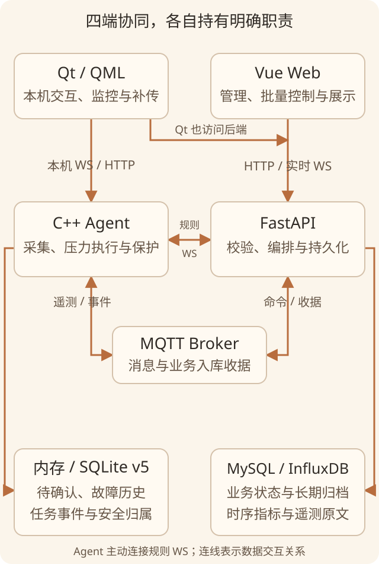

*架构示意：SQLite 由 Agent 管理，MySQL 和 InfluxDB 由后端管理；Qt 通过本机接口读取数据，不直接打开数据库。*

| 角色 | 主要职责 | 通信边界 |
| --- | --- | --- |
| Qt/QML | 本机设置、监控、老化控制、本地历史与补传 | 后端 HTTP/实时 WS；本机 `9800` WS 控制、`9801` HTTP 查询与确认 |
| C++ Agent | 硬件采集、压力运行器、报警判定、本地存储与安全收尾 | MQTT；主动连接后端规则 WS；回环本机接口 |
| FastAPI | 设备与权限、任务编排、消息消费、数据库写入和状态广播 | HTTP、MQTT、`/ws/realtime`、`/ws/agent/{deviceId}` |
| Vue | 综合监控、主机详情、批量操作、告警及后台管理 | 后端 HTTP 与实时 WS，不直接控制压力进程 |

采集和压力执行放进独立 Agent，是为了让 QML 页面专注交互，把系统 API、线程、进程归属与持久化放到统一执行边界。它也让 Windows 与 Linux 共享协议和状态机，分别实现平台能力。**独立进程不等于任由任务脱离管理**：关闭 Qt 时仍需要协调停止本次会话拥有的压力任务。

HTTP 适合查询、配置和明确的控制请求；MQTT 承担设备消息、命令及业务入库收据；WebSocket 承担页面实时推送、规则下发和本机短请求。三种协议的“成功”不能互相替代。

## 2. 从设备接入到日常操作

### 激活、扫码与配置确认

Qt 授权通过后才创建业务 ViewModel；Agent 启动也复用授权检查。授权和业务 `deviceId` 各有职责，设备 ID 不能简单等同于硬件指纹。

接入顺序是 Web 保存当前扫码值，Qt 按本机 IP 拉取、回填，再由操作者确认。**当前扫码值在后端锁内读取后清空，是一次消费**，并非旧文档所说的“读取不消费”，也不是多工位共享队列。之后执行后端登记、本机 `config.update`、Agent 原子保存、匹配 ACK，Qt 才更新生效配置。

排障时常说的 TradeId，在当前保存链路中应查实际字段 **`traceId`**，并关联本机 `requestId`。服务器出现设备号，只说明登记阶段成功；本机 ACK 也不证明后续 MQTT 已连通。配置保存允许 health/登记失败后继续本机离线保存，这与控制命令的选路策略不同。

### 本机看状态，Web 看全局

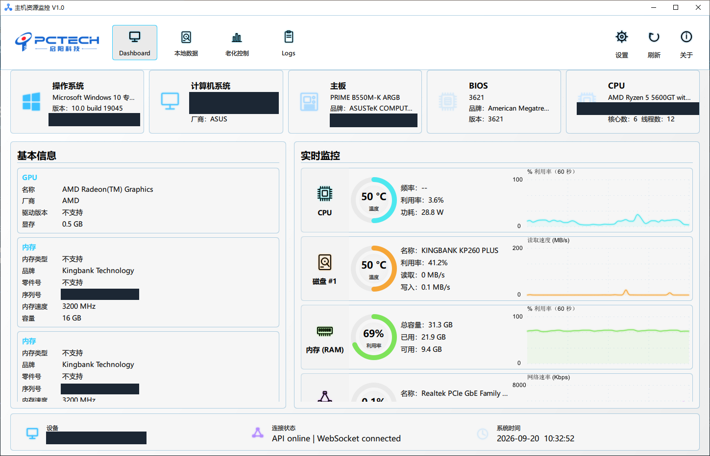

*运行截图：基础信息与实时指标放在同一屏；序列号、UUID、设备标识已遮挡。“不支持”属于有效的能力反馈，不能替换成正常的零值。*

Agent 覆盖 CPU、GPU、内存、磁盘和网络的基本信息及实时指标。Windows 使用系统 API、WMI/PDH 及配置的数据源；Linux 使用 proc、sysfs、DMI、hwmon，按环境接入 GPU 能力。内部保留来源与失败原因，v2 遥测通过 `issues` 描述问题，缺失值保留 `null`。驱动、权限或传感器不可用时，页面应能解释缺失。

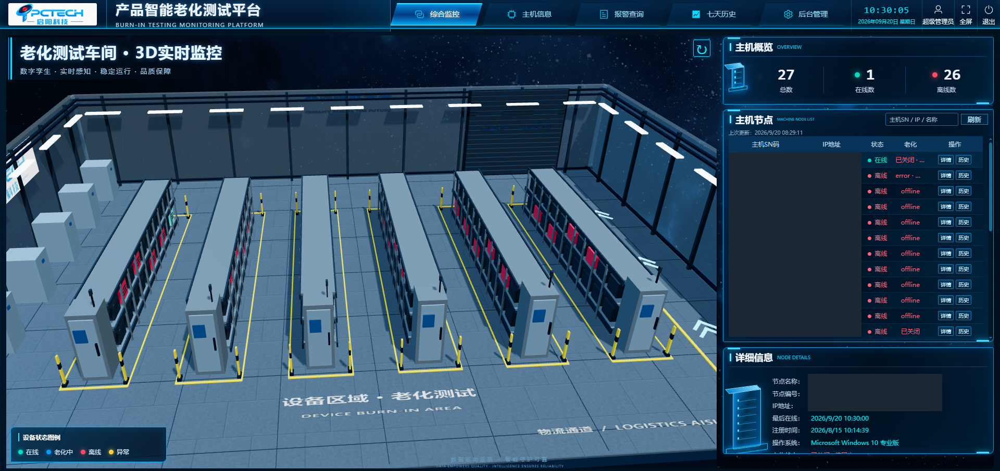

*运行截图：三维车间承载设备状态入口，右侧列表连接到具体主机；这是监控展示，不是对容量或三维仿真精度的测试证明。*

Web 提供综合监控、连接大屏、主机分组与详情、实时曲线、七天历史及长期历史查询。主机分组使用 `batchNo` 等设备属性，与一次命令批次的 `batchId` 分开。另一个“连接大屏”的派生分支会把 Backend/EMQX 节点固定显示在线，不能据此宣称所有通信链路均已实际探活。

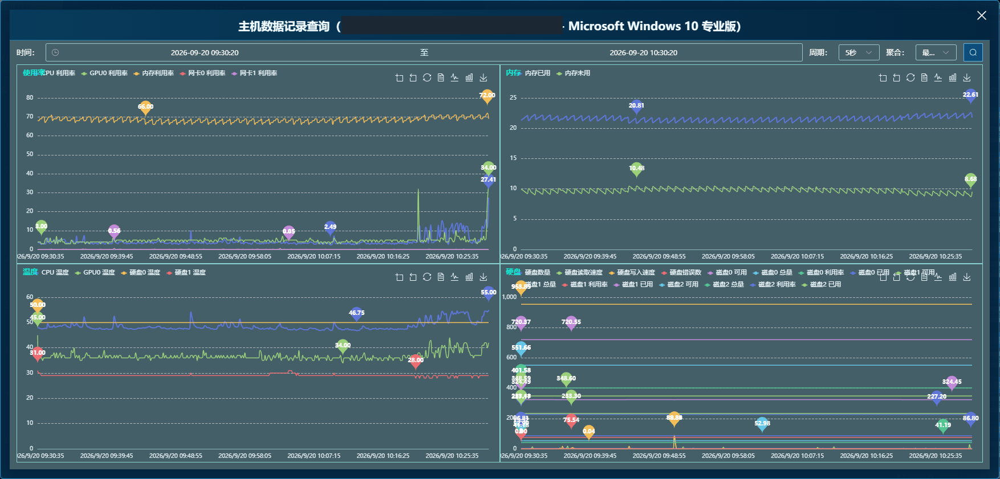

*运行截图：同一时间范围内对照不同指标，便于定位压力过程中的变化；图为裁取的查询弹窗，数值保留原样。*

Qt 还提供本地数据、老化控制、报警设置、日志和外观设置。日志页用于观察客户端过程；RGB 外观设置属于本机能力。LCD 依赖 Windows 随包工具，非 Windows 返回不可用，不应写成全平台功能。Qt 报警设置编辑本地规则，Web 的版本发布则走服务器链路。

## 3. 数据可靠性：确认的是提交，不是发送

| 存储 | 所有者 | 保存什么 |
| --- | --- | --- |
| 内存 | Agent / 后端 / 页面 | Agent 在线待确认与最新展示、后端最新状态、页面状态 |
| SQLite v5 | Agent | 故障历史与 pending、本地老化事件、安全租约和 Linux 执行归属 |
| InfluxDB | 后端 | 时序指标、窗口和完整遥测原文 |
| MySQL | 后端 | 设备、任务、命令、RBAC、告警与长期遥测月表 |

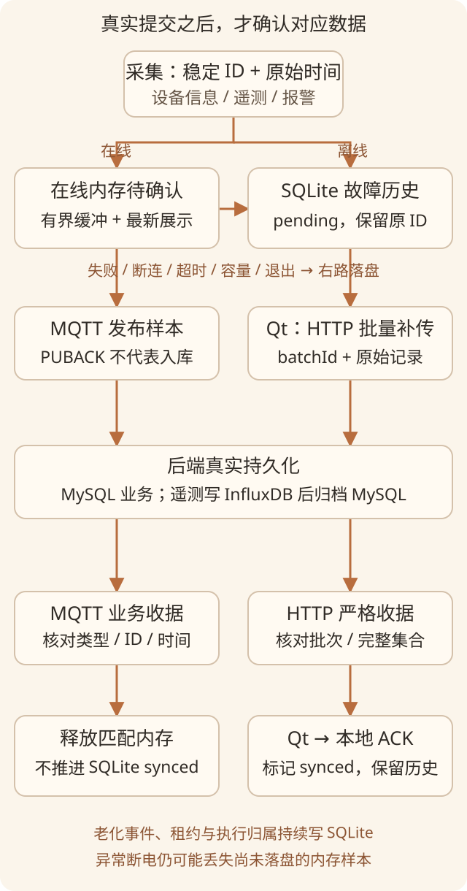

*数据流示意：MQTT 收据释放在线内存，HTTP 补传收据之后的本机 ACK 才标记 SQLite；这两种确认不能混用。*

### 在线缓冲与业务入库收据

在线基本信息、遥测和报警先进入有界内存，待确认上限 **256 条 / 16 MiB**，另保留最新展示快照。后端对遥测写入 InfluxDB 原文、完成 MySQL 归档后，才通过 `agent/{deviceId}/persistence` 返回业务收据。下面是字段关系示例，省略传输封装：

```json
{
  "type": "data.persistence.ack",
  "deviceId": "device-example",
  "persistenceConfirmed": true,
  "records": [
    { "recordType": "telemetry", "recordId": "sample-example", "capturedAt": 1792195200000 }
  ]
}
```

Agent 校验主题、设备、布尔真值、唯一记录集合及类型、原 ID、原时间和已发送状态，只释放匹配的在线项。**MQTT Publish/PUBACK 不代表数据库提交**；确认主题还依赖 Broker ACL 限制发布方，JSON 校验不能替代权限配置。

这不是跨 MySQL/InfluxDB 的原子事务。部分提交后确认失败，可能触发重传，稳定业务 ID 与归档键用于减少重复副作用。异常断电仍可能丢失尚未落盘的内存样本，不能承诺“零丢失”。

### 故障落盘、补传与历史查询

离线以及发送失败、断连、确认超时、容量压力、身份切换和正常退出，会按原 ID 与发生时间转入 SQLite。落盘失败时保留已接受项，缓冲无余量则暂停新遥测采集。老化事件、远端安全租约和执行所有权持续持久化，不经过在线样本确认后即释放的策略。

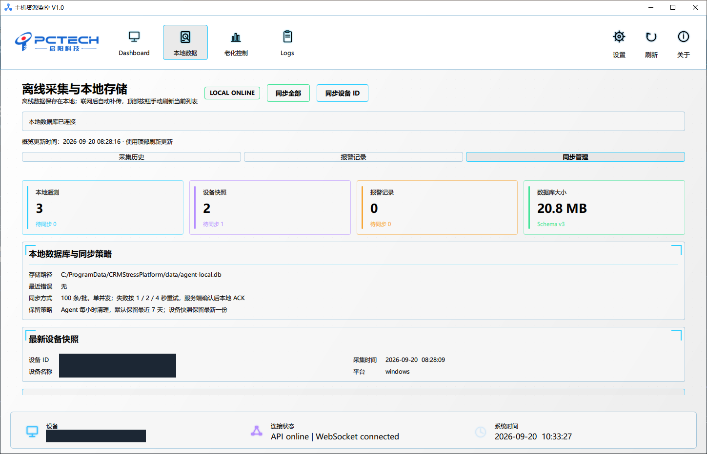

*运行截图：同步管理用于解释本地记录与服务器确认的关系。画面仍标示旧版 Schema v3；本文核对的当前实现为 **SQLite v5**，不能从旧截图推导当前表结构。*

补传由 Qt 读取 `9801` pending，调用后端离线批次接口；严格核对 `persistenceConfirmed`、`batchId` 和完整唯一记录集合后，再向本机 ACK，标记 `synced`，不立即删除历史。默认每批 100 条、单并发、批间 300ms，上传重试 1/2/4 秒，后续自动周期冷却 30～300 秒；协议或权限错误不能靠普通重连无限重试。纯 Agent 不等于已经具备 Qt 这条补传职责。

历史查询在 SQLite 对筛选全集排序后分页，以复合游标保持续页位置；不能仅对屏幕上的一页排序。清理只删除超期且已同步的相应历史，pending 不因保留期到期被删除。

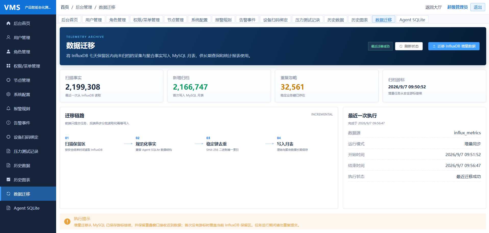

*运行截图：迁移状态展示扫描、归档及重复忽略数量；这些是当次页面记录，不是吞吐量基准。*

长期归档使用 `telemetry_history_YYYYMM` 月表与稳定键，在线确认和离线补传复用相应写入逻辑；另有增量扫描与游标恢复入口。页面提交归档任务的 `202` 仍只表示接受，完成与否要继续查询状态，不能把接口存在当作定时任务已部署。

## 4. 任务控制：请求、命令、任务各有状态

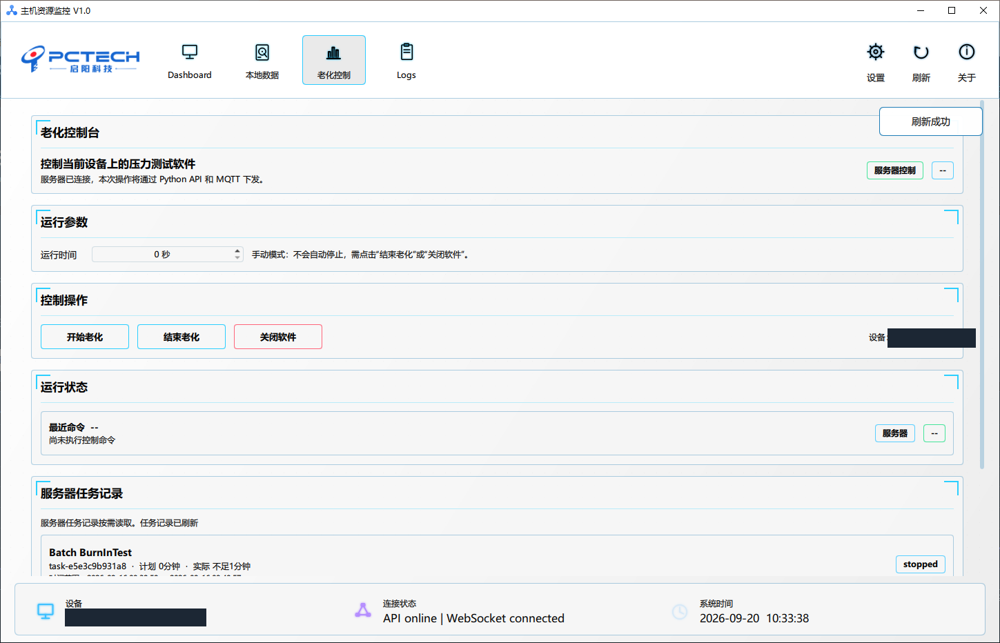

*运行截图：一次控制只选择服务器或本机入口；`0` 秒表示持续运行策略，不表示已经完成，也不允许拿它代替实际老化时长。*

Qt 以“API 可达且 `controlReady`”选择服务器控制，否则使用当前本机 Agent。**一次操作只走一条路，远端失败不自动本地重放**，避免迟到的远端命令和本地操作重复执行。本机 `accepted` 只表示入队，Qt 随后通过 `9801` 老化事件匹配设备、任务和命令，结果未确认时提示超时。

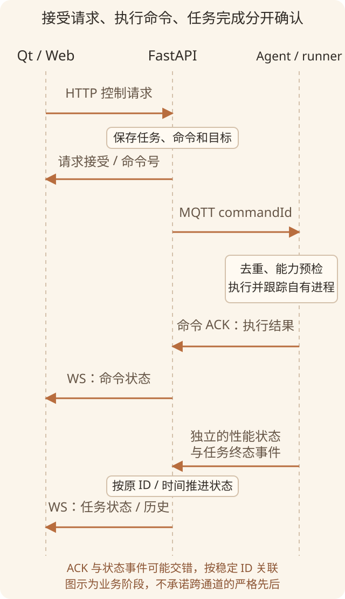

*时序示意：任务开始并非 HTTP 返回的同义词；命令 ACK 与性能状态可能交错，依靠稳定 ID 关联。*

| 阶段 | 能说明什么 | 还不能说明什么 |
| --- | --- | --- |
| HTTP / 本机 accepted | 请求接受或入队 | 压力工具已运行 |
| MQTT 发布 / PUBACK | 消息经过传输层 | Agent 已执行、数据已入库 |
| 命令 ACK | 对应控制动作的执行结果 | 长时间压力任务已完成 |
| 性能状态与终态事件 | 对应任务的运行、停止、完成或失败 | 所有副本都已持久化 |
| 业务持久化收据 | 指定记录已完成适用的存储写入 | 未来永远不丢失 |

单设备与批量合同覆盖开始、停止、复位、关闭；当前主机 UI 只提供开始、结束、关闭，不把所有 API 能力都变成按钮。MQTT 默认 QoS 1 允许重复送达；批量控制保存目标快照，用 `idempotencyKey` 找回已有批次；Agent 对完成命令的去重是有界进程缓存，并非跨重启的永久“恰好一次”保证。

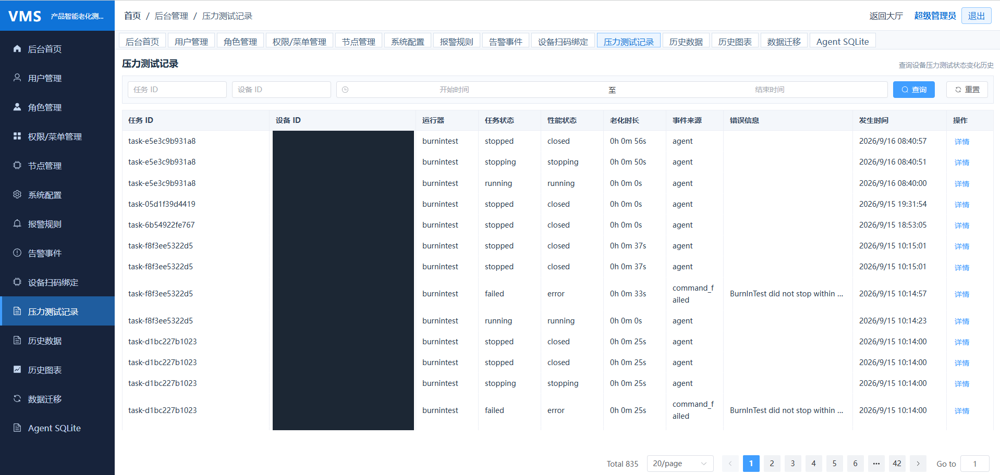

*运行截图：保留失败行和状态变化，便于追查“发过命令”与“执行完成”的差别；重复任务号本身不代表重复创建任务。*

任务历史沿真实事件时间推进，`taskId`、`commandId`、`sessionId`、`eventId` 在重试与补传中保留各自生命周期，迟到事件不能随意倒退终态。正时长的服务端定时停止先确认 stop，再执行 close；失败有重试边界和失败记录。`0` 时长不创建该定时计划，远端安全租约及本地保护仍承担各自职责。

## 5. 告警保护：在 Agent 上闭合执行链

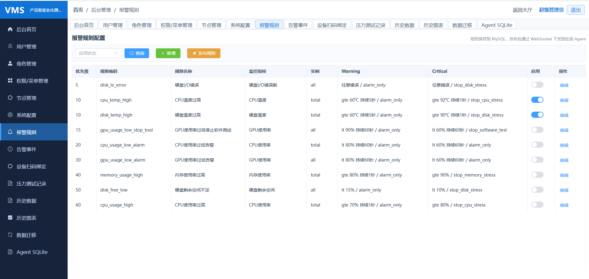

*运行截图：阈值、持续时间和动作共同构成规则；图中数字是现场配置，不是通用安全阈值。*

Web 编辑并发布启用规则，后端生成版本快照，通过 Agent 主动连接的 WS 下发 `alarm.rules.update`。Agent 校验、缓存并回 ACK，在采集后按指标、范围、持续时间和防抖条件判定，再执行报警或停止相应压力项，最后按 `eventId` 上报事件供查询和确认。

把判定和保护动作放在设备侧，减少每次超温都往返服务器的依赖；它不等于停机动作必然成功。事件要保留动作结果，不能把“规则命中”写成“已经停下”。规则版本的整体 applied/failed 状态，也不能证明每台设备都已成功应用。

## 6. 跨平台交付与生命周期

Windows 保留 BurnInTest/AIDA64 及平台采集源，GUI 工具须运行在登录桌面，不能把无界面 Service 当作通用启动器。Qt 6 桌面与 Windows 7 的 Qt 5 构建链分开说明，不能从编译宏推导平台支持。

Linux 当前压力运行器使用本机审核的 `stress` 与 `glmark2-es2`，只接受 CPU、内存、GPU；默认模板禁用 profile。启用前核对版本、SHA-256、user scope/cgroup、资源配额、GPU 归属与温度。远端只能选择已审核 `profileId`，不能下发任意 shell、路径或自由参数；未配置、预检失败和不支持的磁盘请求应明确拒绝。

正常退出时，Linux Agent 在 SQLite 仍打开的阶段收尾自有任务，再刷新未确认数据并关库。supervisor 只监管本次启动的 Qt/Agent，压力运行器依任务号、PID、启动时间和 scope 校验归属，避免按进程名全局清理。异常崩溃恢复同样先确认归属，不能发现旧记录就自动重启压力任务或伪造 completed。

交付复用现有构建入口、Qt/QML 运行库部署、manifest、校验摘要及许可证清单。Ubuntu 20.04/22.04、x86_64/ARM64 的构建基线分别管理，不能仅凭相同归档名认定兼容。桌面包、后端和 Web 独立部署；QEMU、脚本 smoke 或测试断言不替代真实 GPU、压力生命周期和断网恢复验收。

## 7. 完成范围与仍需验证的边界

后台包含登录、用户、角色、菜单/按钮权限、节点、系统配置 CRUD、归档迁移及 Agent SQLite 快照诊断。管理权限会在后端检查，但不能据此称全 API 统一 RBAC；当前兼容登录令牌也不能描述成 JWT。系统配置表的 CRUD 不代表修改后会动态驱动运行 Settings。

SQLite 快照上传用于只读检查与分页诊断，兼容相应版本，不是任意 SQL 执行器，也不等同逐条 pending 补传。旧扫码任务链已退役；报表页面路由停用，`report_record` 缺少当前生产生成方。仅定义的采集能力/运行器模型、Android 及 stress-ng/fio/CUDA 等后续目标，都不列为已交付闭环。

本文核对的是源码中的能力与约束，未重新验收 Broker ACL、数据库迁移和归档调度部署，也未做所有 Windows/Linux 组合的实机测试。后续应重点验证断电窗口、磁盘写入失败、网络恢复、重复与迟到命令、超温动作失败、关闭清理及历史一致性。

这套设计的价值在于让每次交接都有明确责任：设备侧说明做了什么，服务器说明保存了什么，页面说明当前确认到哪一步。工程可靠性来自这些可追踪的边界，而不是一个笼统的“成功”。

### 源码与资料索引

以下为 CRM 根目录下的相对入口，便于对照实现；所列测试本轮仅阅读，未运行：

| 链路 | 源码 / 测试入口 |
| --- | --- |
| 接入与配置 | `03_backend_python_api/app/services/device_scan_service.py`、`01_qt_qml_client/src/services/LocalConfigClient.cpp`；`03_backend_python_api/tests/test_device_scan_config.py` |
| 在线确认 | `02_agent_core_cpp/src/storage/OnlineDataBuffer.cpp`、`03_backend_python_api/app/services/telemetry_pipeline.py`；`03_backend_python_api/tests/test_online_persistence_ack.py` |
| 本地历史与补传 | `02_agent_core_cpp/src/storage/LocalDataStoreQueries.cpp`、`01_qt_qml_client/src/viewmodels/OfflineDataViewModel.cpp`；`02_agent_core_cpp/tests/test_local_data.cpp` |
| 命令、状态与告警 | `02_agent_core_cpp/src/command/CommandDispatcher.cpp`、`03_backend_python_api/app/services/state_consistency_service.py`、`02_agent_core_cpp/src/core/AgentAppAlarm.cpp` |
| 生命周期与交付 | `02_agent_core_cpp/src/core/AgentApp.cpp`、`01_qt_qml_client/scripts/linux/crm-station`、`scripts/linux/` |

整体认识参考 `docs/CRM_架构流程梳理.md`、`docs/CRM_数据架构完整流程梳理.md`、配置与 Qt 设置流程，以及 `Windows说明.md`、`Linux说明.md`、`ubuntu-build-package.md`。文档与源码冲突的扫码消费、在线确认、历史分页和退出顺序，本文均以当前源码为准。
