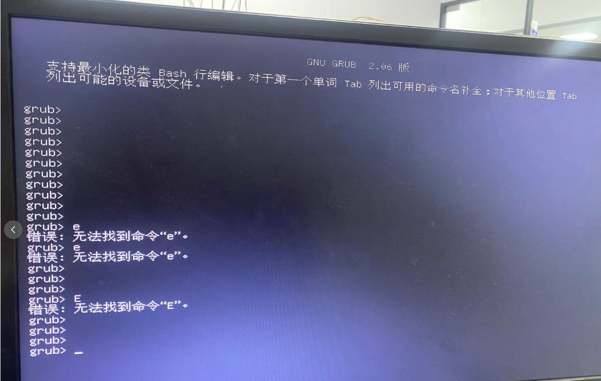
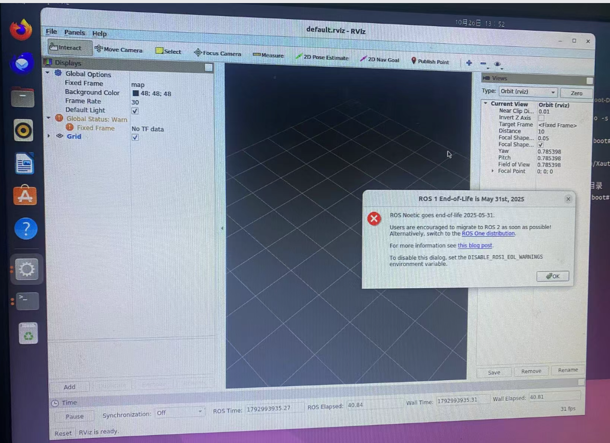
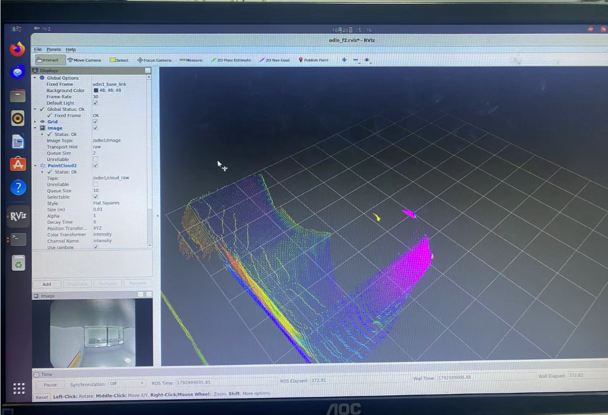

在 Intel i9 主机上运行 Odin ROS 的 Docker 镜像，遇到图形显示或整机卡住时，可以分三步处理：**先检查系统，再确认容器确实用了 GPU，最后检查 ROS 数据和 RViz 配置。**

这里的 Odin 是雷达与图像采集设备，Docker 中运行驱动和 ROS，RViz 用来显示摄像头画面与三维点云。

> 本文按实际使用的 i9 场景整理。目录中完整的排障手册来自另一台 Intel N100，因此下文的旧日志、截图和版本结果均作为参考案例；不代表 i9 已复现相同故障或完成相同测试。本次仅整理博客，未重新操作设备。

## 1. 先把运行环境记清楚

参考环境采用 **Ubuntu 22.04 宿主机 + Ubuntu 20.04 / ROS Noetic 容器**。采集容器使用 `otd1.tgz:v1`，另建 `otd1-rviz-gpu:v1` 运行 GPU 版 RViz，便于单独检查采集与显示。

换到 i9 主机时，先保存自己的环境信息：

```bash
lscpu | grep -E 'Model name|型号名称'
cat /etc/os-release
uname -r
lspci -nnk | grep -A3 -Ei 'VGA|3D|Display'
ls -l /dev/dri/
docker image ls
docker ps -a
```

**CPU 是 i9，不代表图形设备就与 N100 相同。** 是否使用 Intel 核显、实际驱动和 DRM 设备编号，都以本机输出为准。参考记录中的 `card1`、`renderD128` 和 `8086:46d1` 不能直接当成 i9 的设备参数。

## 2. 卡住时，先区分是哪一层出了问题

| 现象 | 先检查什么 |
| --- | --- |
| 容器退出，桌面和 SSH 正常 | 容器日志、退出码、是否被 OOM 终止 |
| RViz 只有空网格 | ROS Master、话题消息、显示类型和坐标系 |
| 桌面不可用，但还能进入 TTY | 根分区空间、显示管理器和图形日志 |
| 鼠标键盘、SSH 一起失去响应 | 内核异常、显卡驱动、内存及硬件稳定性 |

参考案例中，曾出现 `i915` 内核异常、`GPU HANG` 和 `DMAR` 错误；另一次桌面问题则是旧录制数据写满根分区。这是两条不同的故障线，不能统一归因为“Docker 不稳定”。

```bash
df -h /
free -h
sudo journalctl --list-boots
sudo journalctl -k -b --no-pager | \
  grep -Ei 'i915|GPU HANG|Oops|invalid opcode|DMAR.*fault|I/O error'

# 异常重启后，如仍有上次启动日志，检查上一轮
sudo journalctl -k -b -1 --no-pager
```

硬锁死时，本地日志可能来不及落盘。参考案例还使用 netconsole 向 Windows 的 UDP 6666 端口发送内核日志；实际使用前要按当前 IP、网口和接收端重新配置并测试。



*这是引导阶段的画面，Docker 尚未运行。GRUB 菜单中的编辑键与 `grub>` 下的命令不是同一种操作，不能据此判断 ROS 容器崩溃。*

检查容器时，先用 `docker ps -a` 找到实际名称，再替换下面的示例：

```bash
ODIN=odin_gnome_diag_20261026
docker logs --tail 100 "$ODIN"
docker inspect "$ODIN" \
  --format 'Status={{.State.Status}} ExitCode={{.State.ExitCode}} OOMKilled={{.State.OOMKilled}}'
```

`143` 常见于收到 SIGTERM 后退出，`137` 表示 SIGKILL，也可能是停止超时。结合主动停止操作、`OOMKilled` 和日志判断，不能只看一个数字。

## 3. RViz 有窗口，还要确认是不是 GPU 在渲染

参考镜像的 Mesa 21.2.6 无法识别 N100 的核显，出现过下面的日志：

```text
Driver does not support the 0x46d1 PCI ID.
failed to load driver: iris
OpenGL device: llvmpipe
```

`llvmpipe` 表示走 CPU 软件渲染。参考记录在**独立构建容器**中将 Mesa 更新至 25.0.7，保留原镜像后，确认了 Intel GPU 硬件渲染；这不是 i9 必须安装的固定版本，也不能据此认定原始卡死已经修复。

先在本机图形会话中执行 `glxinfo -B`，再在传入 GPU 设备和 X11 授权的容器中执行同一检查，比较 `OpenGL renderer` 和 `Accelerated`。

下面仅适用于**已启用 Intel 核显的 Linux / X11 主机**，且已准备好包含 `glxinfo` 的参考 GPU 镜像。先把设备路径、显示号和授权文件改为本机实际值：

```bash
GPU_CARD=/dev/dri/card1
GPU_RENDER=/dev/dri/renderD128
X11_AUTH=/run/user/1000/gdm/Xauthority
X11_DISPLAY=:0

docker run --rm --hostname "$(hostname)" --network host \
  --device "$GPU_CARD" --device "$GPU_RENDER" \
  -e DISPLAY="$X11_DISPLAY" -e XAUTHORITY=/tmp/odin.Xauthority \
  --mount type=bind,src=/tmp/.X11-unix,dst=/tmp/.X11-unix,readonly \
  --mount "type=bind,src=$X11_AUTH,dst=/tmp/odin.Xauthority,readonly" \
  --entrypoint /bin/bash otd1-rviz-gpu:v1 -lc 'glxinfo -B'
```

期望看到实际 GPU 名称与 `Accelerated: yes`，而不是 `llvmpipe`。X11 授权文件包含认证信息，不要公开；显示测试无需直接开放 `xhost +` 或给 RViz 容器增加 `--privileged`。

## 4. 有图形窗口，还要让图像和点云进来



*参考资料中的初始状态：窗口已打开，只有空网格。弹出的 ROS 生命周期提示也不能用来判断摄像头是否正常。*

先启动已经配置好的采集容器，检查它是否真的在发送消息。以下仍使用参考容器名：

```bash
docker start odin_gnome_diag_20261026
docker exec odin_gnome_diag_20261026 bash -lc '
  source /opt/ros/noetic/setup.bash
  rostopic type /odin1/image
  timeout 10s rostopic hz /odin1/image
  timeout 8s rostopic echo -n 1 /odin1/cloud_raw/header
'
```

`rostopic list` 只能说明话题存在，`rostopic hz` 才能检查是否持续收到消息。计时结束时，`timeout` 返回 124 不一定是采集失败。

参考方案让采集和 RViz 两个容器使用 `--network host`，共同连接 `http://127.0.0.1:11311` 的 ROS Master。它们运行在同一台 Linux 主机上；如果 RViz 连到了另一个空 Master，例如测试用的 11312 端口，自然看不到采集数据。

在 RViz 中添加正确的显示类型：

| RViz 设置 | 参考配置 |
| --- | --- |
| Image → Image Topic | `/odin1/image` |
| PointCloud2 → Topic | `/odin1/cloud_raw` |
| Global Options → Fixed Frame | 与点云头的 `frame_id` 一致，本例为 `odin1_base_link` |

摄像头要添加 **Image**，不能误选 Odometry。不要在没有 `map` 变换时一直保留默认坐标系。



*参考资料中的正常画面：左下角为摄像头，中央为点云，Fixed Frame 使用 `odin1_base_link`。这张图片用于说明配置效果，不作为 i9 性能测试结果。*

## 5. 录制数据要管住磁盘空间

参考历史案例里，约 89GiB 的旧图像与 OLX 数据占满了系统盘。日常只看画面时，应在 `control_command.yaml` 中保持 `recorddata: 0`；这个开关控制 SDK 专有录制，与 `rosbag record` 不是一回事。

```bash
CFG=/root/opt/odin_0.12.0/src/odin_ros_driver/config/control_command.yaml
REC=/root/opt/odin_0.12.0/src/odin_ros_driver/recorddata

grep -n 'recorddata:' "$CFG"
df -h /
sudo du -h --max-depth=1 "$REC" | sort -h | tail -10
```

需要录制时，明确目录、持续时间和容量余量；结束后恢复关闭，并做文件回放检查。文件增长只能证明有写入，不能证明数据完整可用。清理前先备份、停止写入并确认文件不再被进程占用。

RViz 的显示配置也应保存到宿主机挂载目录。参考方案将宿主机 `/root/opt/odin_gui/rviz` 映射到容器 `/root/.rviz`，启动时指定 `rviz -d /root/.rviz/odin_f2.rviz`，避免每次重新添加显示项。

## 6. 当前能确认什么

N100 参考记录中，图像与点云约 10Hz，采集与 GPU RViz 曾重叠运行约 32 分钟；加入录制后的 H2 测试约 10 分钟，未达到原定 20 分钟。图形管理脚本完成过命令行 `start/status/stop` 检查，重启后双击和长期稳定性仍待验证，原始整机卡死根因也未确定。

对于实际 i9 主机，应按**系统与磁盘 → 容器日志 → GPU 渲染 → ROS 消息 → RViz 配置 → 有限时长录制**的顺序逐项验证，并保存自己的日志。当前资料不足以给出 i9 的驱动故障定论或“已经彻底修复”的结论。
