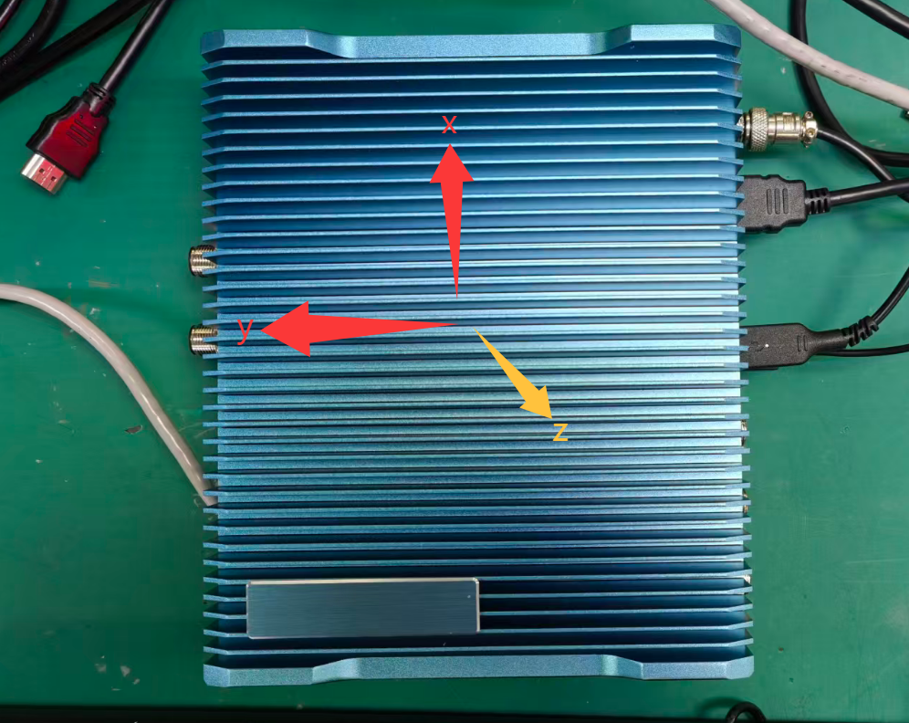
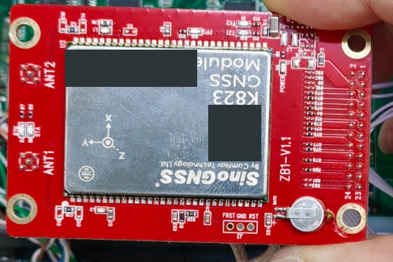
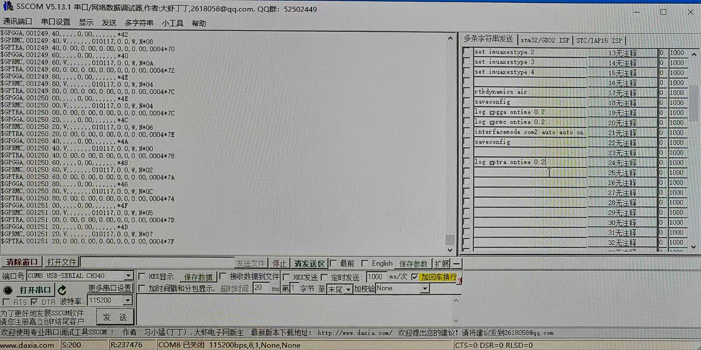

这套设备使用**北天 GNSS 双天线、司南（SinoGNSS）K823 GNSS/INS 板卡和 Linux 主机**。GNSS 负责卫星定位，INS 是惯性导航，需要结合安装方向、传感器与定位信息完成初始化。

这次遇到的问题很典型：**串口一直有数据，设备却没有定位。** 排查天线和供电后，单点定位恢复；惯导轴向、RTK 固定解和行车初始化还需要继续验证。

> 本文依据目录中的整理手册与现场图片编写，整理日期为 2026年10月26日。本次没有重新连接设备测试；下文区分现场已有结果与供应商推荐流程。

## 1. 先认清设备和安装方向



*现场机箱参考方向：Y 指向车头，但它不一定与内部 K823 板卡的 Y 轴一致。*



*板卡局部实物图，保留原始拍摄方向，已遮挡序列标识和二维码。照片中板卡被手持，不能代表最终固定姿态。*

这里要区分两个名字：**北天是天线，K823 板卡是司南产品**。安装时还要分清机箱坐标和板卡坐标，不能看到机箱“Y 向前”就直接选择惯导参数。

先将板卡与车体刚性固定，再比较模块印刷轴向与实际车头方向。行驶中板卡不能相对车体晃动。

## 2. 打通串口收发

原记录的 Linux 串口为 `/dev/ttyS0`，参数为 **115200、8N1、无流控**；Windows 调试使用 SSCOM 和 CH340。Linux 发行版、串口电平及具体引脚没有完整记录，应按自己的主机和载板接线说明核对。

先确认该串口不是系统控制台，并检查是否有其他程序占用：

```bash
ls -l /dev/ttyS0
sudo fuser -v /dev/ttyS0

sudo stty -F /dev/ttyS0 115200 cs8 -cstopb -parenb \
  -ixon -ixoff -crtscts raw -echo
sudo stty -F /dev/ttyS0 -a
```

临时调试时可以开两个 SSH 窗口，**一个读、一个写**。

窗口 A 接收数据：

```bash
sudo cat /dev/ttyS0
```

窗口 B 先查询版本，注意命令以 CRLF 结束：

```bash
printf 'VERSION\r\n' | sudo tee /dev/ttyS0 >/dev/null
```

原记录还发送了 `inscontrol enable`，收到 `INS Enabled!` 和命令接受回显，说明当前双向通信可用。它只证明命令被识别，**不代表惯导已经初始化完成**。

不要同时开多个程序读取同一个串口，否则可能抢读报文。接下来保存日志时，先用 `Ctrl+C` 结束窗口 A 的读取。

## 3. 有数据，不一定有定位



*无定位时依然会连续输出报文；右侧的发送模板也不等于这些配置已经执行成功。*

不必一开始就分析所有 NMEA 字段，先看下面几项：

| 字段 | 故障时 | 恢复后 | 怎么理解 |
| --- | --- | --- | --- |
| GGA 定位质量 | `0` | `1` | 从无有效定位变为 GNSS 单点定位 |
| GGA 参与解算卫星数 | `00` | `15` | 是参与解算数量，不是全部可见卫星数 |
| RMC 状态 | `V` | `A` | 从无效变为有效导航数据 |
| 经纬度 | 空 | 有有效值 | 结合定位质量一起判断 |

**GGA Fix=1 不是 RTK 固定解。** 同样，报文里出现航向或姿态字段，也不能单凭几个数值认定惯导已就绪；低速、静止时的 RMC 航迹角也不一定是车头朝向。

需要留存证据时，直接保存原始数据，比复制滚动终端更可靠：

```bash
# 保存期间只保留这一个串口读取者
sudo timeout 60 cat /dev/ttyS0 > /tmp/k823_verify.log
grep '^\$GPGGA,' /tmp/k823_verify.log | tail -10
grep '^\$GPRMC,' /tmp/k823_verify.log | tail -10
```

如果出现缺字段、拼接行，应检查原始文件及 NMEA 校验和，再判断是终端复制问题还是串口数据异常。

## 4. 这次定位故障怎么排查

先检查开阔环境、天线连接、同轴馈线和有源天线供电，再交叉更换两根天线与两个端口。

现场测量中，两口空载时均约 **3.75V**；接一口天线后，测量的却是**另一空闲端口**，分别出现 0V、1.83V。因此不能把这些值写成“接天线的端口带载电压”，更不能直接认定某个元件短路或损坏。

原记录报告，更改天线供电后，出现了 **GGA Fix=1、15 颗参与解算卫星、RMC=A**，说明基础单点定位恢复。这个变化提示供电链路值得重点检查，但具体故障元件仍未确认。

记录中曾使用 USB 5V 给天线外供电，**不能把它直接照抄成接线方案**。现有资料没有完整供电原理图；天线额定电压、限流以及与板卡原有射频偏置的隔离，都需要硬件人员核对，避免电源直接并联或反灌。

## 5. 定位恢复后，再配置惯导

惯导轴向应以**板卡最终固定后的姿态**为准。按整理手册引用的供应商说明：

| 安装情况 | 对应参数 |
| --- | --- |
| 板卡正面朝上，板卡 Y 轴指向车头 | `imuaxestype 1` |
| 板卡正面朝下，板卡 Y 轴指向车头 | `imuaxestype 5` |
| 其余旋转安装 | 对照供应商的 2～4、6～8 类型，确认旋转视角后选择 |

配置语法如下，尖括号内容必须替换为现场确认的值，不能直接发送：

```text
set imuaxestype <已确认的1至8参数>
saveconfig
```

这只是轴向设置与保存的语法，**不是完整初始化脚本**。供应商流程还包括初始化、保存后完全断电重启、确认单点定位、接入差分达到 RTK 固定解，再按要求向前行车完成 INS 初始化。`freset` 可能清除既有配置，已经正常工作的设备不要为了照着教程操作而直接复位。

输出频率也要按实际需要选择：SSCOM 模板中的 `ontime 0.2` 为 5Hz，供应商流程中的 `ontime 0.1` 为 10Hz。板卡 COM1/COM2 与 Linux 串口的物理映射需要核对，不能把 `/dev/ttyS0` 直接当成 COM2。

之前 SSCOM 曾出现 `Invalid key word`，后续 Linux 测试又接受了 INS 命令；端口、发送格式等原因尚未隔离，不能简单归因为大小写或固件不支持。

目前已确认的是**串口双向通信可用、GNSS 单点定位恢复**。最终轴向配置是否保存、天线外供电长期安全性、RTK 固定解和 INS 行车初始化，仍需现场继续验证。
