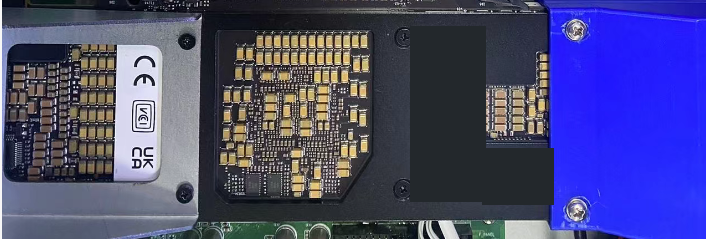
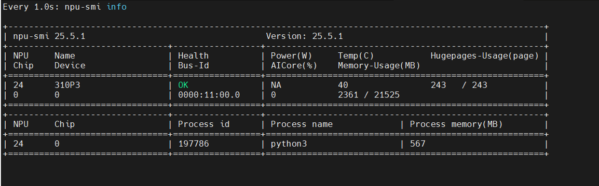
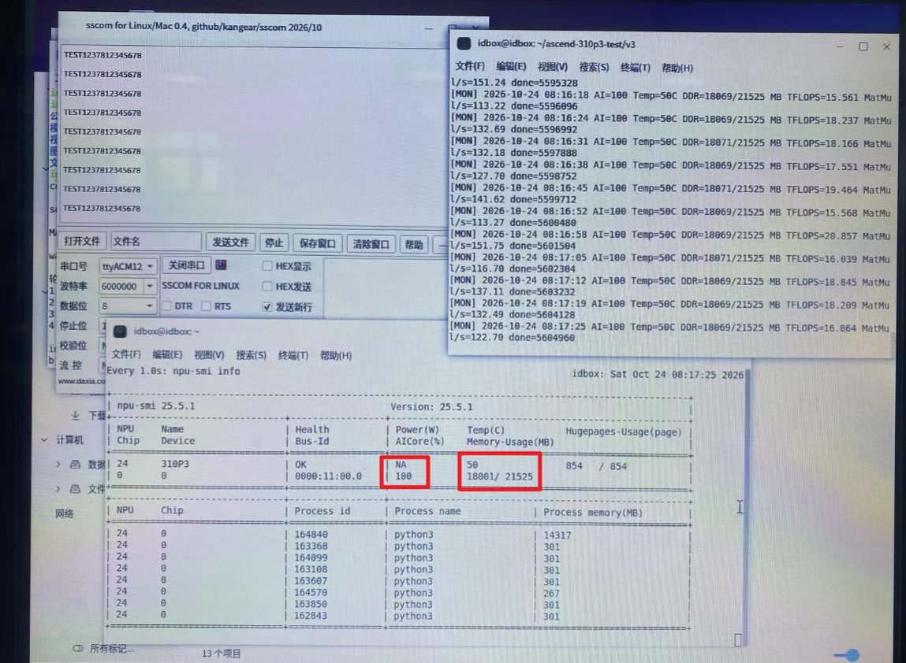

这次在银河麒麟系统上安装华为昇腾 310P3，完成驱动、固件、CANN 环境配置，再用一个 FP16 矩阵乘法模型检查是否真正调用 NPU 计算。

标题沿用“显卡”的叫法，实际设备是面向 AI 推理的 **NPU 算力卡**。本文整理原手册的关键步骤，不展开压测脚本的完整实现。

> 内容来自提供的安装手册及截图，本次仅整理博客，没有重新操作设备。原手册整理于 2026年10月24日；随文提供的运行照片补充了 v3 高显存测试画面。下列安装及转换命令用于复现，未贴出完整执行日志的步骤不视为本次重新验证。

## 1. 测试环境



*实物局部图，发布副本已遮挡卡片标签中的标识信息。*

| 项目 | 本机记录 |
| --- | --- |
| 系统 | 银河麒麟桌面 V10 SP1 |
| CPU 平台 / 架构 | 飞腾平台，ARM64 / aarch64 |
| 内核 | `5.4.18-85-generic` |
| 算力卡 | 华为昇腾 310P3，NPU 内存总量 21525 MB |
| 驱动 / 固件安装包 | `25.5.1` / `7.8.0.6.201` |
| CANN | Toolkit 与 310P OPS，均为 `8.5.0` |
| Python | `3.8.10` |
| 测试模型 | 两个 4096×4096 FP16 矩阵的 MatMul |

先检查系统和 PCIe 设备，安装包必须使用对应的 ARM64 版本：

```bash
cat /etc/os-release
uname -r
uname -m
lspci | grep -Ei 'Huawei|Phytium|accelerator'
```

本机华为设备位于 `11:00.0`。飞腾平台也会显示 NPU Controller，不能把它当成昇腾卡。

## 2. 安装驱动与固件

准备以下两个安装包，原记录将它们放在 `~/桌面/driver/`：

```text
Ascend-hdk-310p-npu-driver_25.5.1_linux-aarch64.run
Ascend-hdk-310p-npu-firmware_7.8.0.6.201.run
```

创建运行用户和安装目录，再安装驱动：

```bash
getent group HwHiAiUser || sudo groupadd HwHiAiUser
id HwHiAiUser 2>/dev/null || \
  sudo useradd -m -g HwHiAiUser -s /bin/bash HwHiAiUser

sudo mkdir -p /opt/ascend-install
sudo cp ~/桌面/driver/*.run /opt/ascend-install/
sudo chown root:root /opt/ascend-install/*.run
sudo chmod 700 /opt/ascend-install/*.run
cd /opt/ascend-install

sudo bash ./Ascend-hdk-310p-npu-driver_25.5.1_linux-aarch64.run \
  --full --install-for-all
```

原记录出现 `Driver package installed successfully!`。随后安装固件并重启：

```bash
sudo bash ./Ascend-hdk-310p-npu-firmware_7.8.0.6.201.run --full
sync
sudo reboot
```

重新登录后检查：

```bash
cat /usr/local/Ascend/driver/version.info
sudo dkms status
lsmod | grep -E 'davinci|devmm|drv_pcie'
npu-smi info -l
npu-smi info
```



*运行截图：管理卡编号为 24，Chip 为 0；这一采样的 AI Core 为 0%，不能只看模型进程存在就判断正在持续计算。*

这里有两个不同编号：**本机 `npu-smi` 的 Card ID 是 24，AscendCL / ais_bench 使用的 Device ID 是 0**，以各工具实际枚举结果为准：

```bash
npu-smi info -t board -i 24 -c 0
npu-smi info -t usages -i 24 -c 0
```

固件安装程序报告升级成功，但 `board` 查询的 Firmware Version 为 `NA`，所以运行固件的详细版本仍未从该查询确认。已经安装成功的机器，不必为了检查状态重复安装。

## 3. 安装 CANN 与 Python 工具

将两个 CANN 安装包放到 `~/ascend-packages/`，先安装 Toolkit，再安装 310P OPS：

```bash
cd ~/ascend-packages
sudo bash ./Ascend-cann-toolkit_8.5.0_linux-aarch64.run --install
sudo bash ./Ascend-cann-310p-ops_8.5.0_linux-aarch64.run --install
source /usr/local/Ascend/cann/set_env.sh

which atc
atc --help
python3 -c 'import acl; print("ACL OK")'
```

本机实际路径为 `/usr/local/Ascend/cann-8.5.0`，`cann` 指向该目录。每次新开终端先加载环境；这版 ATC 不支持 `atc --version`，用 `--help` 检查即可。

手册记录的依赖版本为 NumPy `1.24.4`、SciPy `1.10.1`、Protobuf `3.20.3`；生成模型还需要 ONNX。以下为准备依赖的示例，ONNX 需选择与当前 Python 兼容的版本：

```bash
python3 -m pip install --user \
  numpy==1.24.4 scipy==1.10.1 protobuf==3.20.3 onnx
```

ais_bench 沿用原资料中的源码安装方式，仓库内路径需以实际下载版本为准：

```bash
mkdir -p ~/ascend-310p3-test
cd ~/ascend-310p3-test
git clone --depth 1 https://gitee.com/ascend/tools.git
cd tools/ais-bench_workload/tool/ais_bench
export CANN_PATH=/usr/local/Ascend/cann
python3 -m pip install --user -v ./backend
python3 -m pip install --user -v .
python3 -m ais_bench --help
```

安装后继续用同一个普通用户运行。若遇到 `/dev/davinci0 access denied`，先检查当前用户组和设备权限。原机器的临时处理方式是：

```bash
sudo usermod -aG HwHiAiUser "$USER"
# 加组后重新登录，再检查权限
ls -l /dev/davinci0
sudo setfacl -m "u:$(whoami):rw" /dev/davinci0
test -r /dev/davinci0 && test -w /dev/davinci0 && echo 'DEVICE ACCESS OK'
```

`setfacl` 可能在重启或设备节点重建后失效，不能当作已完成的永久权限配置。也不要直接改用 root 跑测试：普通用户的 `~/.local` 依赖不一定对 root 可见。

## 4. 生成 OM 模型并运行测试

这里测试的是 **FP16 MatMul 算子模型**，不是大语言模型。先生成 ONNX，再用 ATC 转换成 310P3 使用的 OM。

先建立测试目录：

```bash
mkdir -p ~/ascend-310p3-test/models ~/ascend-310p3-test/scripts
```

将下面的代码保存为 `~/ascend-310p3-test/scripts/create_matmul.py`，主要逻辑沿用手册：

```python
import onnx
from onnx import helper, TensorProto, checker

N = 4096
A = helper.make_tensor_value_info('A', TensorProto.FLOAT16, [N, N])
B = helper.make_tensor_value_info('B', TensorProto.FLOAT16, [N, N])
C = helper.make_tensor_value_info('C', TensorProto.FLOAT16, [N, N])
node = helper.make_node('MatMul', inputs=['A', 'B'], outputs=['C'])
graph = helper.make_graph([node], 'Ascend310P3_FP16_MatMul', [A, B], [C])
model = helper.make_model(graph, opset_imports=[helper.make_operatorsetid('', 13)])
model.ir_version = 8
checker.check_model(model)
onnx.save(model, 'matmul_fp16_4096.onnx')
```

转换并运行：

```bash
source /usr/local/Ascend/cann/set_env.sh
cd ~/ascend-310p3-test/models
python3 ../scripts/create_matmul.py

atc --model=matmul_fp16_4096.onnx --framework=5 \
  --output=matmul_fp16_4096 \
  --input_shape='A:4096,4096;B:4096,4096' \
  --soc_version=Ascend310P3

python3 -m ais_bench \
  --model ./matmul_fp16_4096.om \
  --device 0 --loop 500 --warmup_count 20 \
  --pure_data_type random --batchsize 1
```

`--framework=5` 表示 ONNX，`--soc_version` 填目标芯片型号。输入名和形状要与模型一致。模型应是实际文件；原测试版本的 ais_bench 会拒绝指向 OM 的软链接。

在另一个终端观察：

```bash
watch -n 1 npu-smi info
```

原记录已经成功加载并执行 `matmul_fp16_4096.om`；上面是整理后的复现步骤，原稿没有保留 ATC 转换的完整成功日志。

## 5. 运行结果与几个注意点



*提供的运行照片：终端路径为 v3，日志时间为 2026年10月24日；此时 AI Core 为 100%，内存为 18001 / 21525 MB。*

原手册记录 v2 的 4 worker 测试曾采样到 AI Core 100%；随文的新照片进一步展示了 v3 约 18 GB 的内存占用，补充了原稿“v3 尚无实机输出”的状态。不过，单张照片仍不能证明 24 小时稳定运行、持续峰值算力或停止后的内存释放情况，图中的 TFLOPS 日志也不能直接当成完整基准结果。

简单记住这几项即可：

- `lspci` 可见、驱动正常、模型加载和真正执行计算，是不同阶段。
- 曾出现 `import acl` 后退出段错误，后续最小 Runtime 连续 5 次通过；原始故障根因没有确认。
- 设备权限报错先查用户和 `/dev/davinci0`；缺少 `ais_bench` 则检查当前用户的 Python 环境。
- 增加 worker 不一定更快；显存占用增加也不等于计算量增加。
- 原压测脚本的 75°C 是自定义停止阈值，不是官方温度上限。先做短时测试，再延长运行，并保留散热、温度和错误日志。

本文保留的是从安装到单模型运行的简化路径；多进程常驻推理、显存保持和统计脚本的完整实现不在这里展开。
