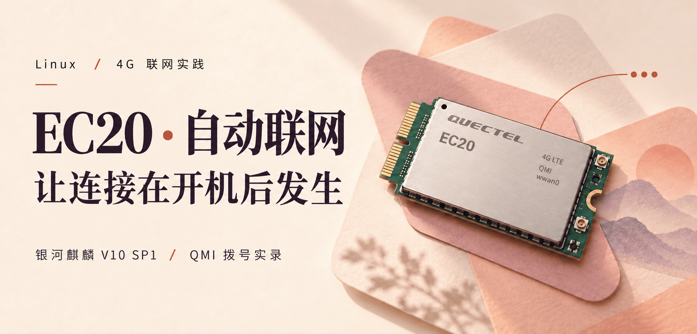
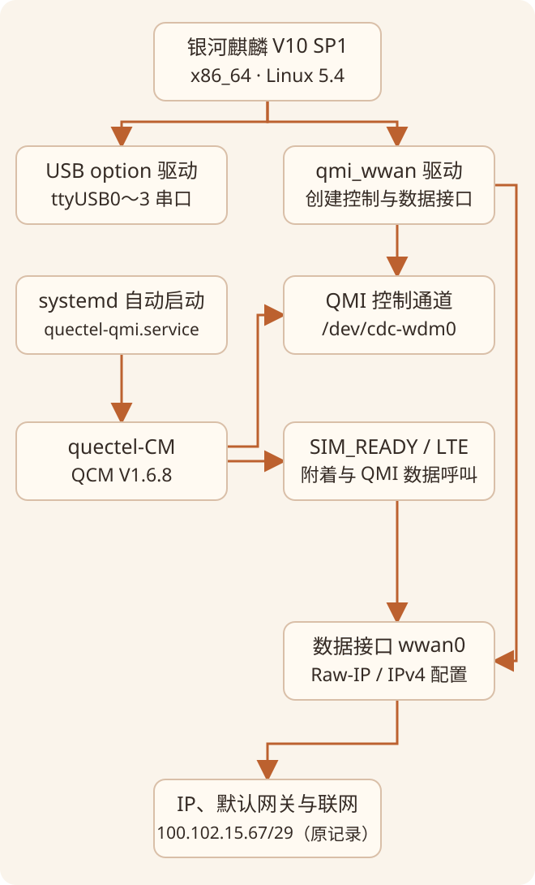
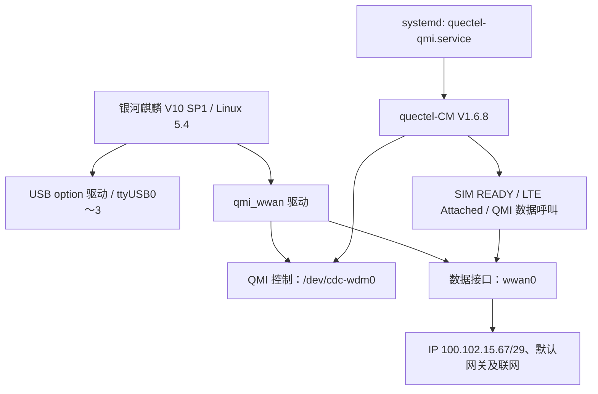
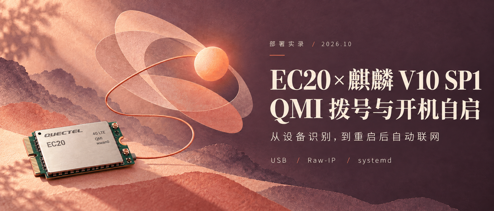
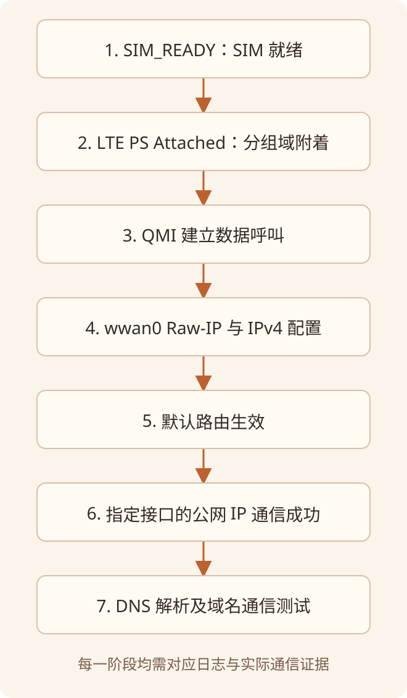
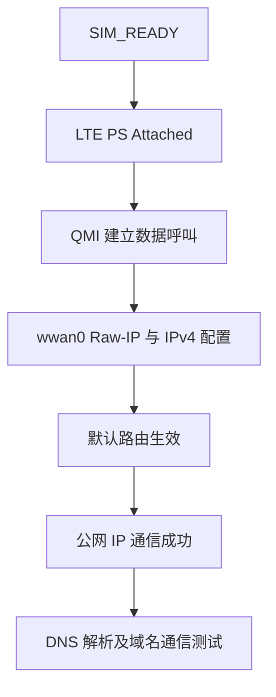

本文记录移远 EC20 在银河麒麟 V10 SP1 x86 工控机上的 4G 联网实践：从设备识别、手动 QMI 拨号，到 systemd 开机自启和实际重启后的联网检查，并保留中间出现的异常及排查过程。

> 原稿记录及整理日期为 2026年10月16日。下文“本机”“已执行”“已验证”均指用户提供的原始部署实录；本次博客整理没有重新操作设备，也没有读取原稿所指的其他聊天记录。命令、输出和验证边界按原文保留，示例地址、PID 和路径应按自己的环境核对。



*两张配图均为主题插画，发布副本已中文化说明并去除模组二维码，不代表本机硬件照片或实测输出。*

> **文档类型**：工程实施记录 / 运维知识库 / 可复现部署指南  
> **整理日期**：2026-10-16  
> **记录来源**：用户提供的 EC20 部署实录中的命令、实际日志和技术讨论  
> **证据说明**：`[已验证]` 表示原始记录中包含成功输出；`[已执行但结果有限]` 表示确有操作但不能据此推出完整成功；`[失败/异常]` 表示日志明确出现失败或警告；`[待验证]` 表示仅讨论或未提供测试记录；`[推断]` 表示依据日志作出的技术判断，尚非直接证实。

## 1. 导读与结果概览

### 1.1 背景与目标

现场为一台 **银河麒麟桌面操作系统 V10（SP1）、x86_64、Linux 5.4.18-110-generic** 工控机，连接移远 EC20 4G 模组。目标是插入有效 SIM 后能够接入移动网络，且**插好 SIM 开机时自动识别设备、自动拨号上网**，避免每次人工执行 `quectel-CM`。

采用的方案为：Linux `option` 串口驱动和 `qmi_wwan` 网络驱动负责硬件接口，`quectel-CM`（QConnectManager V1.6.8）负责 QMI 数据连接，`systemd` 负责开机启动及程序退出后的自动重启。

### 1.2 最终结论

| 目标/指标 | 最终记录 | 结论 |
| --- | --- | --- |
| USB 枚举、串口及 QMI 控制通道 | `2c7c:0125`、`ttyUSB0`～`ttyUSB3`、`/dev/cdc-wdm0` | **[已验证]** |
| QMI 数据网卡 | `wwan0`，驱动 `qmi_wwan` | **[已验证]** |
| SIM 就绪与 LTE 注册 | `SIM_READY`；`MCC 460 / MNC 0`；`PS: Attached`；`DataCap: LTE` | **[已验证]** |
| 手动拨号上网 | `100.102.15.67/29`；Ping `1.1.1.1` 四次成功 | **[已验证]** |
| 开机自动拨号 | 重启后服务 `enabled`、`active (running)`；自动配置 IP、路由 | **[已验证]** |
| DNS 及域名访问 | `getent` 解析百度域名；`ping -I wwan0 www.baidu.com` 四次成功 | **[已验证]** |
| 服务稳定性（观测点） | 手动进程退出后 `NRestarts=0`、主 PID 稳定；重启后服务运行 | **[已验证：有限观测窗口]** |
| 长时间断线重连、SIM 带电热插拔 | 未提供断网恢复、拔插 SIM 的实际测试 | **[待验证]** |
| 有线优先/4G 备用持久路由 | 仅讨论优先级，未实施 | **[待配置]** |

> **范围边界**：本实录针对麒麟 x86 主机上的 EC20，不是其他设备上的 RG200U/ECM 或 RK3588；不能把其他设备的操作结果视为本机证据。

## 2. 实际环境、设备与软件信息

### 2.1 系统与设备

| 类别 | 实际值或状态 | 证据来源 / 备注 |
| --- | --- | --- |
| 主机名 | `boot-pc` | Shell 提示符与 `uname -a` |
| 当前登录用户 | `boot` | Shell 提示符 |
| 操作系统 | 银河麒麟桌面操作系统 V10 (SP1) | `/etc/os-release` |
| `PRETTY_NAME` | `Kylin V10 SP1` | `/etc/os-release` |
| `ID` / `ID_LIKE` | `kylin` / `debian` | `/etc/os-release` |
| `VERSION_ID` / `KYLIN_RELEASE_ID` | `v10` / `2403` | `/etc/os-release` |
| 内核 | `5.4.18-110-generic` | `uname -r` |
| 内核构建标识 | `#99-KYLINOS SMP Fri Mar 29 09:28:06 UTC 2024` | `uname -a` |
| CPU 架构 | `x86_64` | `uname -a`；具体 CPU 型号**未提供** |
| 4G 模组 | Quectel EC20 系列 | 基带版本 `EC20CEHDLGR06A14M1G` |
| USB VID:PID | `2c7c:0125` | `lsusb` 及拨号日志 |
| `lsusb` 产品文字 | `EC25 LTE modem` | USB ID 数据库描述；**不覆盖基带版本识别出的 EC20** |
| 4G USB 速度 | `480M`（USB 2.0 High-Speed） | `lsusb -t` |
| USB 串口驱动 | `option` | `lsusb -t` |
| QMI 网络驱动 | `qmi_wwan` | sysfs 链接、`lsusb -t`、内核日志 |
| QConnectManager | `QConnectManager_Linux_V1.6.8` | 程序运行日志 |
| BusyBox `udhcpc` | `v1.30.1` | DHCP 输出 |
| 网络管理工具 | NetworkManager CLI（`nmcli` 可用）；`wwan0` 未列入已管理设备 | 实际 `nmcli device status`；不得据此推断所有配置 |
| 模组固件完整硬件修订、SIM_DET 接线 | **未提供** | 不推定支持 SIM 带电热插拔 |

### 2.2 网络接口与地址

| 接口 | 实际信息 | 用途/状态 |
| --- | --- | --- |
| `enp2s0` | `192.168.31.223/24`，MAC `8c:c5:8c:1c:27:bc`，网关 `192.168.31.1` | 有线网卡，持续为 UP/RUNNING |
| `enp5s0` | MAC `8c:c5:8c:1c:27:bd`，无 IPv4、无收发数据 | 第二块有线网卡，未建立有效连接 |
| `wwan0`（拨号前） | 无 IPv4、`DOWN` | 网卡已枚举，尚未建立数据连接 |
| `wwan0`（拨号后） | `100.102.15.67/29`，网关 `100.102.15.68` | 移动网络，QMI Raw-IP |
| `lo` | `127.0.0.1` | 回环接口 |

拨号后的重要路由：

```text
default via 100.102.15.68 dev wwan0
default via 192.168.31.1 dev enp2s0 proto dhcp metric 100
100.102.15.64/29 dev wwan0 proto kernel scope link src 100.102.15.67
169.254.0.0/16 dev enp2s0 scope link metric 1000
192.168.31.0/24 dev enp2s0 proto kernel scope link src 192.168.31.223 metric 100
```

`100.102.15.67` 落在 `100.64.0.0/10` 运营商级共享地址（CGNAT）范围内，**不是可直接供公网入站访问的普通公网 IPv4 地址**。本次未配置公网入站访问或 SSH 反向隧道。

### 2.3 关键路径与文件

| 路径 | 功能 | 状态 |
| --- | --- | --- |
| `/home/boot/桌面/Quectel_QConnectManager_Linux_V1.6.8/` | QCM 源码、Makefile、已有可执行文件 | [已出现]；原始记录没有展示编译命令 |
| `/home/boot/桌面/Quectel_QConnectManager_Linux_V1.6.8/quectel-CM` | 手动拨号可执行文件 | [已成功运行] |
| `/opt/quectel-qcm/quectel-CM` | systemd 正式执行文件 | [已安装并成功运行] |
| `/opt/quectel-qcm/default.script` | 从源码目录复制的 DHCP 脚本 | [已复制]；**不是已证实的 BusyBox 默认搜索路径** |
| `/opt/quectel-qcm/default.script_ip` | 从源码目录复制的辅助脚本 | [已复制] |
| `/etc/systemd/system/quectel-qmi.service` | 自动拨号服务单元 | [已创建/启用/运行] |
| `/dev/ttyUSB0`～`/dev/ttyUSB3` | 模组 USB 串口 | [已存在] |
| `/dev/cdc-wdm0` | QMI 控制通道 | [已存在且被拨号进程使用] |
| `/sys/class/net/wwan0/qmi/raw_ip` | QMI Raw-IP 模式开关 | [QCM 已自动写入 `Y`] |
| `/etc/udhcpc/default.script`、`/usr/share/udhcpc/default.script` | 可能的 udhcpc 默认脚本位置 | **[待验证]**；不能声称已安装 |

## 3. 需求背景与方案演变

### 3.1 初始现象

最初运行 `ifconfig` 时，只显示活动的 `enp2s0`、未连接的 `enp5s0` 与 `lo`；`ifconfig -a` 才显示 `wwan0`。与此同时，`lsusb` 能看到 `2c7c:0125`，`/dev/ttyUSB*` 有四个节点。

由此可以判断：**模组 USB 枚举与串口识别并不等于已完成 4G 拨号**。缺少的是 SIM/运营商状态确认、QMI 数据呼叫，以及接口 IP/路由配置。

### 3.2 需求演变

1. **最初目标**：SIM 插入后自动识别网卡并能上网；该次调试选用 EC20 的 QMI + `quectel-CM`。
2. **第一阶段**：确认 QMI 驱动、`cdc-wdm0`、`wwan0`、SIM 注册和手动拨号是否正常。
3. **第二阶段**：部署 `systemd`，实现插好 SIM 后**开机自动拨号**。
4. **第三阶段**：解决手动进程与自动服务并存引起的控制通道竞争风险。
5. **第四阶段**：通过真实重启、IP、Ping、DNS 测试验证服务。
6. **后续提出但未配置**：4G 自动重连、SIM 运行中热插拔、有线与 4G 的上网优先级。

### 3.3 架构



<details>
<summary>展开流程图的原始 Mermaid 源码</summary>



</details>

说明：实际模组通过 USB 接入 Linux，控制通道和数据网卡属于同一个物理模组；图示没有引入额外网络设备。

## 4. 完整实施过程（按实际时间顺序）

### 4.1 确认操作系统、内核与网络现状 — [已执行]

**目的**：确定目标系统及内核版本，区分已识别设备和已拨通网络。

```bash
cat /etc/os-release
uname -a
uname -r
ifconfig
ifconfig -a
```

关键结果：

```text
PRETTY_NAME="Kylin V10 SP1"
VERSION_ID="v10"
KYLIN_RELEASE_ID="2403"
Linux boot-pc 5.4.18-110-generic #99-KYLINOS ... x86_64 ... GNU/Linux
enp2s0: inet 192.168.31.223
wwan0: flags=4098<BROADCAST,MULTICAST> ... RX packets 0 ... TX packets 0
```

**分析**：`ifconfig` 默认只显示符合其显示条件的接口，`ifconfig -a` 包括未激活接口。因此 `wwan0` 出现在 `-a` 中说明网卡已创建，但**不是拨号成功证据**。

### 4.2 确认 USB 枚举和串口节点 — [已执行]

```bash
lsusb
ls /dev/ttyUSB*
```

关键输出：

```text
Bus 001 Device 003: ID 2c7c:0125 Quectel Wireless Solutions Co., Ltd. EC25 LTE modem
/dev/ttyUSB0  /dev/ttyUSB1  /dev/ttyUSB2  /dev/ttyUSB3
```

**分析**：USB ID 的文字描述为 EC25，不能只依据 `lsusb` 文本给模组定型。后续 `quectel-CM` 从基带读到 `EC20CEHDLGR06A14M1G`，与原始记录中的 EC20 信息一致。USB 枚举正常，不应首先去重新编译 USB 串口驱动。

### 4.3 检查 QMI 设备、驱动绑定及占用 — [已执行]

```bash
ls -l /dev/cdc-wdm*
readlink -f /sys/class/net/wwan0/device/driver
lsusb -t
ip link show wwan0
ip -4 addr show wwan0
pgrep -af 'quectel-CM|ModemManager|qmi-network'
nmcli device status
sudo dmesg | grep -Ei 'quectel|qmi|wwan|cdc-wdm|ttyUSB'
```

关键输出：

```text
crw------- 1 root root 180, 0 ... /dev/cdc-wdm0
/sys/bus/usb/drivers/qmi_wwan
... If 4, Class=Vendor Specific Class, Driver=qmi_wwan, 480M
... If 0/1/2/3, Driver=option, 480M
4: wwan0: <BROADCAST,MULTICAST> ... state DOWN
```

`ip -4 addr show wwan0` 无输出；最初 `pgrep` 无匹配进程；`nmcli device status` 只列出 `enp2s0`（已连接）、`enp5s0`（不可用）和 `lo`（未托管）。

```text
[    7.058756] usb 1-4: GSM modem (1-port) converter now attached to ttyUSB0
[    7.058983] usb 1-4: GSM modem (1-port) converter now attached to ttyUSB1
[    7.059187] usb 1-4: GSM modem (1-port) converter now attached to ttyUSB2
[    7.059318] usb 1-4: GSM modem (1-port) converter now attached to ttyUSB3
[    7.107138] qmi_wwan 1-4:1.4: cdc-wdm0: USB WDM device
[    7.108123] qmi_wwan 1-4:1.4 wwan0: register 'qmi_wwan' ... WWAN/QMI device
```

**结论**：`option`、`qmi_wwan`、QMI 控制通道与数据网卡都已正常出现。本阶段没有必要重编驱动。`/dev/cdc-wdm0` 权限为 `crw------- root root`，随后使用 `sudo` 拨号合理。

### 4.4 手动启动 QConnectManager — [已执行、拨号成功]

**位置**：

```bash
cd ~/桌面/Quectel_QConnectManager_Linux_V1.6.8
sudo ./quectel-CM
```

原始程序日志节选（日志时间为设备本地 CST）：

```text
[10-16_10:49:46:636] QConnectManager_Linux_V1.6.8
[10-16_10:49:46:638] Find /sys/bus/usb/devices/1-4 idVendor=0x2c7c idProduct=0x125
[10-16_10:49:46:639] Auto find qmichannel = /dev/cdc-wdm0
[10-16_10:49:46:639] Auto find usbnet_adapter = wwan0
[10-16_10:49:46:639] netcard driver = qmi_wwan, driver version = 22-Aug-2005
[10-16_10:49:46:639] Modem works in QMI mode
[10-16_10:49:46:958] requestBaseBandVersion EC20CEHDLGR06A14M1G
[10-16_10:49:47:086] requestGetSIMStatus SIMStatus: SIM_READY
[10-16_10:49:47:149] requestGetProfile[pdp:1 index:1] cmnet///0/IPV4V6
[10-16_10:49:47:181] requestRegistrationState2 MCC: 460, MNC: 0, PS: Attached, DataCap: LTE
[10-16_10:49:47:213] requestQueryDataCall IPv4ConnectionStatus: DISCONNECTED
[10-16_10:49:47:278] requestSetupDataCall WdsConnectionIPv4Handle: 0x8727d680
[10-16_10:49:47:405] ip link set dev wwan0 up
```

**解析**：

- `SIM_READY`：SIM 可用；不等于网络已经成功拨通。
- `MCC 460, MNC 0`：模组识别到移动网络运营商标识；结合 `cmnet` APN 属于本次实际环境。
- `PS: Attached, DataCap: LTE`：已附着 LTE 分组域。
- `DISCONNECTED`：建立数据呼叫前，IPv4 数据连接尚未建立，不能当成持续故障。
- `requestSetupDataCall` 返回句柄：QMI 数据呼叫已获得句柄；是否真正上网仍要以 IP、路由和端到端通信验证。
- `driver version = 22-Aug-2005`：这是工具打印的驱动字符串，**不是已经核实的内核包构建日期**。

### 4.5 首轮 DHCP 失败、Raw-IP 切换与最终成功 — [异常后自动恢复]

手动拨号时首先出现：

```text
No default.script found, it should be in '/usr/share/udhcpc/' or '/etc//udhcpc'
busybox udhcpc -f -n -q -t 5 -i wwan0
udhcpc: sending discover
udhcpc: sending discover
udhcpc: sending discover
udhcpc: sending discover
udhcpc: sending discover
udhcpc: no lease, failing
```

随后 `quectel-CM` 自行执行：

```text
File:ql_raw_ip_mode_check Line:143 udhcpc fail to get ip address, try next:
ip link set dev wwan0 down
echo Y > /sys/class/net/wwan0/qmi/raw_ip
ip link set dev wwan0 up
busybox udhcpc -f -n -q -t 5 -i wwan0
udhcpc: sending select for 100.102.15.67
udhcpc: lease of 100.102.15.67 obtained, lease time 7200
ip -4 address flush dev wwan0
ip -4 address add 100.102.15.67/29 dev wwan0
ip -4 route add default via 100.102.15.68 dev wwan0
```

**正确解读**：

1. 第一轮 DHCP 失败是**确实发生过的局部失败**，最终没有导致整个拨号任务失败。
2. 程序切换 `raw_ip=Y` 后 DHCP 成功，说明 QMI 数据帧格式与接口模式高度相关；本机程序已自动完成这个切换。
3. `No default.script found` 是**独立警告**。实际 IP 和默认路由由 `quectel-CM` 后续命令设置成功，但不能由此声称 udhcpc 脚本位置和 DNS 下发方式已完全正确。
4. 没有证据证明“缺失 default.script”就是首次 DHCP Discover 无租约的根因；首次失败与 Raw-IP 模式不匹配更直接相关，严格根因归属仍应保持审慎。

`udhcpc` 参数说明：

| 参数 | 含义 |
| --- | --- |
| `-f` | 前台运行 |
| `-n` | 未获得租约时退出，而非无限等待 |
| `-q` | 获取租约后退出 |
| `-t 5` | 发送 DHCP 请求的最大尝试次数配置（具体语义以该 BusyBox 版本帮助为准） |
| `-i wwan0` | 指定数据接口 `wwan0` |

### 4.6 手动拨号后独立验证 4G 流量 — [已执行]

```bash
ip -4 addr show wwan0
ip -4 route
ping -I wwan0 -c 4 1.1.1.1
```

关键结果：

```text
wwan0: <POINTOPOINT,MULTICAST,NOARP,UP,LOWER_UP>
inet 100.102.15.67/29 scope global wwan0
default via 100.102.15.68 dev wwan0
default via 192.168.31.1 dev enp2s0 proto dhcp metric 100
4 packets transmitted, 4 received, 0% packet loss
rtt min/avg/max/mdev = 128.606/133.354/142.719/5.538 ms
```

**判断依据**：`ping -I wwan0` 显式选择 4G 接口，避免已有 `enp2s0` 连通时通过有线网卡误判 4G 成功。

### 4.7 安装 QCM 到固定目录 — [已执行]

源目录已存在 `quectel-CM`、`default.script`、`default.script_ip`、`Makefile`、C 源文件等。原始记录**没有**展示执行 `make` 或 gcc 构建该版本的过程，故不补写虚构编译步骤。

已实际执行：

```bash
cd ~/桌面/Quectel_QConnectManager_Linux_V1.6.8
sudo install -d /opt/quectel-qcm
sudo install -m 755 ./quectel-CM /opt/quectel-qcm/quectel-CM
sudo install -m 644 ./default.script /opt/quectel-qcm/
sudo install -m 644 ./default.script_ip /opt/quectel-qcm/
```

**说明**：`install -d` 创建目录；`-m 755` 赋予可执行权限，`-m 644` 复制为非可执行普通文件。由于 `udhcpc` 会在其默认搜索路径寻找**可执行**脚本，把 `default.script` 以 644 放在 `/opt/quectel-qcm/` 并不能证明已经消除缺失脚本警告。本次最终联网成功不依赖额外声称该警告已经修复。

### 4.8 创建并启用 systemd 服务 — [已执行]



*配图为主题插画，用于说明开机自启主题，不作为现场照片或测试证据。*

曾尝试：

```bash
sudo nano /etc/systemd/system/quectel-qmi.service
```

输出：

```text
sudo: nano：找不到命令
```

**处理**：改用系统已有的 `vim`：

```bash
sudo vim /etc/systemd/system/quectel-qmi.service
```

最后由 `systemctl cat quectel-qmi.service` **实际核实**的内容为：

```ini
[Unit]
Description=Quectel EC20 QMI Auto Dial
After=network.target
Wants=network.target
StartLimitIntervalSec=0

[Service]
Type=simple
WorkingDirectory=/opt/quectel-qcm
ExecStart=/opt/quectel-qcm/quectel-CM
Restart=always
RestartSec=10

[Install]
WantedBy=multi-user.target
```

随后执行：

```bash
sudo systemctl daemon-reload
sudo systemctl enable quectel-qmi.service
sudo systemctl start quectel-qmi.service
systemctl status quectel-qmi.service
sudo journalctl -u quectel-qmi.service -f
```

启用服务时输出：

```text
Created symlink /etc/systemd/system/multi-user.target.wants/quectel-qmi.service → /etc/systemd/system/quectel-qmi.service.
```

第一次状态为 `active (running)`，但日志暂时只出现 systemd 启动行，**仅凭这一点不能确认服务已独占 QMI 通道或真正拨号**。

配置解释：

- `Type=simple`：systemd 将启动的长期运行程序作为主服务进程。
- `WorkingDirectory`：设定启动工作目录。
- `ExecStart`：启动已安装的 `quectel-CM`；避免依赖桌面源码路径。
- `Restart=always` 与 `RestartSec=10`：程序退出后由 systemd 10 秒后尝试重新启动；并不保证所有“进程还在但网络掉线”的情形都能恢复。
- `StartLimitIntervalSec=0`：取消常规时间窗口内的重启频率限制；故障时可能持续循环重启，需要通过 `NRestarts` 观察。
- `After=network.target` 只规定服务排序，**不保证移动模组 USB 节点或 SIM 已准备好**。

### 4.9 排查手动拨号与自动服务竞争 — [已定位并消除当前冲突]

最初手动运行 `sudo ./quectel-CM`，其后又启动 systemd，检查到：

```bash
systemctl cat quectel-qmi.service
pgrep -af 'quectel-CM|ectel-CM'
sudo fuser -v /dev/cdc-wdm0
systemctl show quectel-qmi.service -p MainPID -p ActiveState -p SubState -p NRestarts
```

最初输出：

```text
20212 sudo ./quectel-CM
20215 ./quectel-CM
36516 (ectel-CM)
/dev/cdc-wdm0: root 20215 F.... quectel-CM
```

多次 `fuser` 后，通道占用者变为服务进程：

```text
/dev/cdc-wdm0: root 37646 F.... quectel-CM
MainPID=37646
NRestarts=13
ActiveState=active
SubState=running
```

**原因分析**：手动进程与 systemd 进程在同一时间段存在，存在争夺唯一 QMI 控制通道的风险；`NRestarts=13` 说明当时服务已发生多次重新启动。两者具有明显时间相关性，但没有完整退出错误栈，因此“13 次全由竞争造成”仍属 **[推断]**。

后续记录：

```bash
ps -p 20212,20215,37646 -o pid,ppid,stat,etime,args
pgrep -af 'quectel-CM|ectel-CM'
```

```text
PID    PPID STAT ELAPSED COMMAND
37646      1 Ssl  03:01 /opt/quectel-qcm/quectel-CM
37646 /opt/quectel-qcm/quectel-CM
```

证明原先手动 PID `20212/20215` 已不存在，拨号只剩 systemd 主进程。**原始记录中没有展示手动进程究竟是按 Ctrl+C 还是自行退出，因此不应记成某一种具体退出操作。**

随后明确执行：

```bash
sudo systemctl restart quectel-qmi.service
systemctl show quectel-qmi.service -p MainPID -p NRestarts -p ActiveState -p SubState
sudo fuser -v /dev/cdc-wdm0
```

连续检查结果：

```text
MainPID=39033
NRestarts=0
ActiveState=active
SubState=running
/dev/cdc-wdm0: root 39033 F.... quectel-CM
```

再次查看仍然 `MainPID=39033`、`NRestarts=0`，同时 `wwan0` 有 IP，`ping -I wwan0 1.1.1.1` 四次全成功（平均 `136.887 ms`）。

**结论**：当前观察窗口内，重复拨号进程已消失，唯一 systemd 进程独占 QMI 通道，重启次数没有增加。

### 4.10 实际重启测试 — [已执行且通过]

原始记录执行：

```bash
sudo reboot
```

重新登录后未再手动运行 `quectel-CM`，直接检查：

```bash
systemctl status quectel-qmi.service
ip -4 addr show wwan0
ping -I wwan0 -c 4 1.1.1.1
ifconfig
```

关键输出：

```text
Loaded: loaded (/etc/systemd/system/quectel-qmi.service; enabled; vendor preset: enabled)
Active: active (running) since Fri 2026-10-16 11:16:08 CST
Main PID: 1599 (quectel-CM)
Tasks: 2
Memory: 4.2M
└─1599 /opt/quectel-qcm/quectel-CM
```

服务日志证明它自动进行 Raw-IP 切换、DHCP 和 IP 路由设置：

```text
10月 16 11:16:24 ... echo Y > /sys/class/net/wwan0/qmi/raw_ip
10月 16 11:16:25 ... busybox udhcpc -f -n -q -t 5 -i wwan0
10月 16 11:16:25 ... udhcpc: lease of 100.102.15.67 obtained, lease time 7200
10月 16 11:16:25 ... ip -4 address add 100.102.15.67/29 dev wwan0
10月 16 11:16:25 ... ip -4 route add default via 100.102.15.68 dev wwan0
```

端到端测试：

```text
4 packets transmitted, 4 received, 0% packet loss
rtt min/avg/max/mdev = 122.398/124.311/126.810/1.611 ms
```

**结论**：插好 SIM、重启系统后，开机自动拨号成功。不需要终端人工执行 `quectel-CM`。

### 4.11 DNS 与域名实测 — [已执行且通过]

```bash
getent ahostsv4 www.baidu.com
ping -I wwan0 -c 4 www.baidu.com
systemctl show quectel-qmi.service -p MainPID -p NRestarts -p ActiveState
```

关键输出：

```text
39.156.70.46    STREAM www.a.shifen.com
39.156.70.46    DGRAM
39.156.70.46    RAW
39.156.70.239   STREAM
39.156.70.239   DGRAM
39.156.70.239   RAW
```

```text
PING (39.156.70.239) from 100.102.15.67 wwan0
icmp_seq=1 time=282 ms
icmp_seq=2 time=47.2 ms
icmp_seq=3 time=50.8 ms
icmp_seq=4 time=36.9 ms
4 packets transmitted, 4 received, 0% packet loss
rtt min/avg/max/mdev = 36.892/104.174/281.757/102.654 ms
```

服务状态：

```text
MainPID=1599
NRestarts=0
ActiveState=active
```

**结论**：DNS 名称解析正常，且指定从 `wwan0` 向域名对应 IP 发送 Ping 成功。首包 282 ms、随后 36.9～50.8 ms，短样本无法证明长期网络质量问题。

## 5. 故障与排查总表

| 编号 | 问题现象 | 证据与原因分析 | 采取的方法 | 验证状态 |
| --- | --- | --- | --- | --- |
| P01 | `ifconfig` 未出现 `wwan0` | `ifconfig -a` 可见 DOWN 网卡；不等于驱动缺失 | 检查所有接口、QMI 驱动及 IP | **[已确认]** 接口已创建，待拨号 |
| P02 | `lsusb` 把设备写为 EC25 | `2c7c:0125` 对应设备数据库文字；基带返回 EC20 固件 | 以 QMI `requestBaseBandVersion` 补充识别 | **[已确认]** EC20 基带版本 |
| P03 | `wwan0` 无 IPv4 | QMI 控制通道存在，但起初尚未建立数据呼叫 | 手动 `sudo ./quectel-CM` | **[解决并验证]** |
| P04 | 首轮 DHCP 没有租约 | 工具在切换 Raw-IP 之前连续发送 Discover 无响应 | QCM 自动设置 `raw_ip=Y`，再次调用 `udhcpc` | **[解决并验证]** |
| P05 | `No default.script found` | QCM 提示默认脚本位置缺失；已安装到 `/opt` 不等于 udhcpc 能找到 | 文中提供检查与条件性补齐方案 | **[警告未单独验证消除]**，联网可用 |
| P06 | `sudo nano` 无法执行 | 本机找不到 `nano` | 改用 `sudo vim` | **[已解决]** |
| P07 | 服务存在却没有拨号日志、MainPID 显示异常形式 | 当时有手动进程与服务进程并存；日志输出也可能受缓冲影响 | 对比 `pgrep`、`fuser`、systemd MainPID | **[已定位服务所有权]** |
| P08 | `NRestarts=13` | 多次重启与双进程争用 QMI 通道时间重合；不是完全证实的唯一根因 | 确保只剩服务进程，重启服务后重复核查 | **[当前观察窗口解决]**：`NRestarts=0` |
| P09 | 开机后是否自动拨号不确定 | 仅 `enable` 不足以证明拨号成功 | 实际 `sudo reboot`，检查 systemd、IP 与 Ping | **[已验证]** |
| P10 | 4G 和有线均有默认路由 | 4G 路由无显式 metric；有线为 `metric 100`，正常将偏向 4G | 讨论路由优先级与有线备用策略 | **[尚未调整]** |
| P11 | SIM 插入即自动联网是否包含“带电插卡” | 未给出 SIM_DET 接线及热插拔试验 | 需查硬件/固件支持，再做受控测试 | **[待验证]** |

> **工程判断原则**：同一时间出现“进程冲突”与“多次重启”时，可以认定是高度可疑原因，但没有失败日志不能把所有重启直接归因于冲突；文档只记录有证据的结论。

## 6. 最终可复现方案

### 6.1 前置条件

1. 麒麟 V10 SP1（本机 Linux `5.4.18-110-generic`）已经能枚举 EC20 USB 设备。
2. `option` 驱动生成 `ttyUSB0`～`ttyUSB3`，`qmi_wwan` 生成 `wwan0` 和 `/dev/cdc-wdm0`。
3. SIM 卡有效，模组注册 LTE；本机 APN 为 `cmnet`，默认运行 QCM 即能读取原有配置。
4. 已有适用于本机 CPU 架构的 `quectel-CM` V1.6.8 可执行文件；**原始记录不包含它的构建过程**。
5. 确保同一时间只启动一个控制 `/dev/cdc-wdm0` 的 QMI 管理程序。

### 6.2 推荐部署顺序

1. 只读检查 USB、驱动、控制节点、SIM、当前路由。
2. 在本地终端手动运行 `sudo ./quectel-CM`，核实 QMI、IP、Ping；**同一时间不要启动 systemd 服务**。
3. 手动拨号进程结束后，复制二进制到 `/opt/quectel-qcm`。
4. 使用第 4.8 节所列、原始记录中已经实测的 `quectel-qmi.service`，然后执行 `daemon-reload`、`enable`、`start`。
5. 通过 `systemctl show`、`pgrep`、`fuser` 确保只有一个拨号进程，PID 与控制通道占用对应。
6. 查看 `wwan0` 的 IP/路由、指定接口 Ping。
7. 在有本地恢复手段的前提下重启主机，不手动启动拨号程序，重复验收。
8. 最后测试 DNS、长期运行及故障恢复（后两者尚未在原始记录中完全覆盖）。

已验证的安装命令与服务配置见第 4.7～4.8 节。部署后的常用管理命令：

```bash
sudo systemctl daemon-reload
sudo systemctl enable quectel-qmi.service
sudo systemctl start quectel-qmi.service
systemctl status quectel-qmi.service
systemctl show quectel-qmi.service -p MainPID -p NRestarts -p ActiveState
sudo journalctl -u quectel-qmi.service -n 100 --no-pager
```

### 6.3 `default.script` 的处理（仅建议，未在原始记录中验证安装）

如果服务日志仍提示脚本缺失，应先查 BusyBox 帮助及现有文件，**不要直接覆盖系统原脚本**：

```bash
busybox udhcpc --help 2>&1 | grep -E 'default.script|PROG'
ls -l /etc/udhcpc/default.script /usr/share/udhcpc/default.script
```

若确认实际默认路径为 `/etc/udhcpc/default.script`、且该文件不存在，可考虑：

```bash
sudo install -d /etc/udhcpc
sudo install -m 755 /opt/quectel-qcm/default.script /etc/udhcpc/default.script
```

**状态：仅建议，未执行/未验收**。`/opt/quectel-qcm/default.script` 已复制，但其当前权限为 644。脚本内容应先审查，确认不会覆盖本机已有 DNS 与有线网络配置后再应用；如系统已有其他实现，优先分析原配置。

### 6.4 运行结果的限制

- 本机自动连接证据针对 **开机前 SIM 已可用** 的情形。
- `Restart=always` 是“程序退出后的重启”，不能替代所有拨号质量监控、信号检测或链路可达性检测。
- EC20 的内部 SIM 插拔检测依赖设备固件及 PCB SIM_DET 接线，不能因系统重启后自动联网成功而断言支持带电插拔。整机或模组断电上电未单独验证。
- 如需要“有线优先，4G 备用”，必须进一步设计持久路由 metric 与链路健康判断。仅靠两条默认路由的 metric，通常只能处理路径消失的情形，无法充分发现网关/公网不可达但链路仍显示 UP 的故障。

## 7. 关键技术原理与易混淆概念

### 7.1 USB 枚举、串口、QMI 数据接口是三个层面

| 层面 | 作用 | 本次证据 | 容易误判的地方 |
| --- | --- | --- | --- |
| USB 设备 | 系统知道模组接在 USB 上 | `lsusb 2c7c:0125` | 不意味着 SIM 就绪或网络已通 |
| 串口 | 提供 AT 等控制接口 | `ttyUSB0`～`ttyUSB3` | 不意味着已经拨号 |
| QMI 控制 | 建立/查询移动数据会话 | `/dev/cdc-wdm0` | 节点存在也不意味着已有 IP |
| 网络接口 | 接受 IP 配置并传输数据 | `wwan0` | DOWN/无 IP 与驱动不存在不同 |
| IP 层 | 地址、路由、DNS | `100.102.15.67/29`、默认路由 | 有 IP 不代表域名访问必然成功 |

### 7.2 QMI Raw-IP 与普通以太网

本机在成功拨号后：

```text
wwan0: <POINTOPOINT,MULTICAST,NOARP,UP,LOWER_UP>
unspec 00-00-00-00-00-00-00-00-00-00-00-00-00-00-00-00
```

在 Raw-IP 模式下，数据通道传送 IP 数据包，不使用普通以太网 ARP/MAC 封装，因此 `NOARP`、`POINTOPOINT` 与 `unspec` 形式可以是**正常表现**。QCM 通过向 `raw_ip` 写入 `Y` 后成功获取 IP，恰好反映了该差异。不要仅因没有传统 MAC 形式就重新安装网卡驱动。

### 7.3 LTE 注册、QMI 会话、DHCP、DNS 不等价



<details>
<summary>展开流程图的原始 Mermaid 源码</summary>



</details>

每一阶段都需匹配证据：本机最终已经通过这条链路的系统重启后自动拨号与域名访问验收。

### 7.4 DNS 测试与网络接口选择

`getent ahostsv4 www.baidu.com` 验证系统解析器是否能解析域名，但**并未单独证明 DNS 查询一定通过 `wwan0` 发出**；`ping -I wwan0 www.baidu.com` 可验证解析得到目标后，ICMP 流量通过指定的 4G 接口通信。综合两者，足以证明本机当时“域名解析 + 4G 到目标 IP 可达”。

### 7.5 路由 metric 与双网络

本机同时存在：

```text
default via 100.102.15.68 dev wwan0
default via 192.168.31.1 dev enp2s0 proto dhcp metric 100
```

未指定 metric 的第一条默认路由通常按 metric 0 比较，会优先于有线的 metric 100。它解释了为什么普通 IPv4 上网倾向走 4G（具体下一跳可通过 `ip -4 route get 1.1.1.1` 核实；该命令在原始记录中被建议，但**未贴出实际执行输出**）。

注意：发往 `192.168.31.0/24` 的流量有更具体的直连路由，仍可通过 `enp2s0`；默认路由与局域网直连路由的优先级不能混为一谈。

### 7.6 systemd 的作用与边界

- `enabled`：表示安装了开机启动关联，不等于已完成拨号。
- `active (running)`：表示服务进程存活，不等于互联网可达。
- `MainPID`：systemd 认为该服务的主进程 PID。
- `NRestarts`：服务当前生命周期内已自动重启的次数；看是否持续上涨比看单次值更有用。
- `fuser /dev/cdc-wdm0`：判断谁正在占用 QMI 控制节点，可交叉核对 `MainPID`。
- 真正成功的证据组合是：**唯一 QMI 控制进程 + 网卡 IP/路由 + 指定接口公网通信 + 真实重启后的重复成功**。

## 8. 关键命令速查表

| 命令 | 功能 | 使用场景 | 记录状态 / 注意事项 |
| --- | --- | --- | --- |
| `cat /etc/os-release` | 系统版本 | 环境确认 | [已执行] |
| `uname -a`、`uname -r` | 内核与架构 | 驱动匹配 | [已执行] |
| `ifconfig`、`ifconfig -a` | 查看接口（包括未激活） | 网卡是否创建 | [已执行] |
| `lsusb`、`lsusb -t` | 枚举设备、驱动、速率 | USB 与驱动排障 | [已执行]；文字型号需交叉验证 |
| `ls /dev/ttyUSB*` | 检查串口节点 | USB option 驱动 | [已执行] |
| `ls -l /dev/cdc-wdm*` | 查看 QMI 通道与权限 | 拨号前检查 | [已执行] |
| `readlink -f /sys/class/net/wwan0/device/driver` | 查看绑定驱动 | QMI/其他模式区分 | [已执行] |
| `ip link show wwan0` | 接口链路及标志位 | DOWN、Raw-IP 状态 | [已执行] |
| `ip -4 addr show wwan0` | 查看 IPv4 地址 | 拨号结果验证 | [已执行] |
| `ip -4 route` | 查看路由 | 双默认路由分析 | [已执行] |
| `ip -4 route get 1.1.1.1` | 解析实际出站路由 | 判断普通流量走哪个接口 | [仅建议] |
| `nmcli device status` | 查看 NetworkManager 设备 | 识别是否被 NM 管理 | [已执行] |
| `sudo dmesg \| grep -Ei 'quectel\|qmi\|wwan\|cdc-wdm\|ttyUSB'` | 过滤内核日志 | 驱动识别 | [已执行] |
| `sudo ./quectel-CM` | 手动拨号 | 首次验证 | [已执行成功]；服务运行后不要重复执行 |
| `sudo install -d /opt/quectel-qcm` | 创建安装目录 | 安装 QCM | [已执行] |
| `sudo install -m 755 ...` | 安装可执行文件 | 固定运行路径 | [已执行] |
| `sudo vim /etc/systemd/system/quectel-qmi.service` | 编辑服务单元 | systemd 部署 | [已执行] |
| `sudo systemctl daemon-reload` | 载入新的 unit 配置 | 修改 service 后 | [已执行] |
| `sudo systemctl enable quectel-qmi.service` | 启用开机自启 | 自动拨号 | [已执行] |
| `sudo systemctl start quectel-qmi.service` | 启动服务 | 首次部署 | [已执行] |
| `sudo systemctl restart quectel-qmi.service` | 重新启动服务 | 单实例恢复验证 | [已执行成功]；短暂中断 4G |
| `systemctl cat quectel-qmi.service` | 核对实际 unit 内容 | 配置审计 | [已执行] |
| `systemctl status quectel-qmi.service` | 服务状态/近期日志 | 开机验收 | [已执行] |
| `systemctl show quectel-qmi.service -p MainPID -p NRestarts -p ActiveState` | PID、重启数、服务状态 | 稳定性观测 | [已执行] |
| `pgrep -af 'quectel-CM\|ectel-CM'` | 查重复拨号进程 | QMI 竞争诊断 | [已执行] |
| `sudo fuser -v /dev/cdc-wdm0` | QMI 控制节点占用者 | 单实例校验 | [已执行] |
| `ps -p 20212,20215,37646 -o pid,ppid,stat,etime,args` | 查指定 PID 状态 | 故障复盘 | [已执行]；这些 PID 非永久值 |
| `sudo journalctl -u quectel-qmi.service -f` | 实时查看日志 | 拨号状态观察 | [已执行]；Ctrl+C 退出 |
| `sudo journalctl -u quectel-qmi.service -n 100 --no-pager` | 最近 100 条服务日志 | 后续故障排查 | [仅建议] |
| `sudo reboot` | 重启系统 | 验证开机自启 | [已执行成功]；会断开 SSH |
| `ping -I wwan0 -c 4 1.1.1.1` | 强制通过 4G 测试公网 IP | 排除有线网卡干扰 | [已执行成功] |
| `getent ahostsv4 www.baidu.com` | IPv4 域名解析 | DNS 检查 | [已执行成功] |
| `ping -I wwan0 -c 4 www.baidu.com` | 通过 4G Ping 域名 | 解析与 4G 可达性综合测试 | [已执行成功] |
| `busybox udhcpc --help` | 查脚本默认目录与参数 | 修复 `default.script` 警告 | [仅建议] |

## 9. 常见错误、操作风险与工程建议

1. **不要把 `lsusb`、`ttyUSB`、`wwan0` 出现等同于联网成功。** 按 USB → 驱动 → QMI → SIM → 注册 → IP → 路由 → DNS 逐层验证。
2. **不要让两个 `quectel-CM` 同时控制一个 `/dev/cdc-wdm0`。** 本次出现了重复进程与 13 次自动重启；确认退出手动程序后再把 systemd 作为唯一管理者。
3. **不要直接用 `killall quectel-CM` 清理进程。** 它可能同时结束正在提供网络的 systemd 服务进程。优先在最初手动拨号的终端按 Ctrl+C；若进程已退出，不进行多余杀进程操作。
4. **不要因为 `raw_ip=Y` 就怀疑网卡没有真实 MAC 是错误。** Raw-IP 的 `POINTOPOINT`、`NOARP` 特征与普通以太网不同。
5. **不要把 `No default.script found` 忽略成“没有影响 DNS 的可能性”。** 本机已经成功解析域名，但脚本警告是否消除尚未证明；如需完整修复，先查实际脚本目录与 DNS 管理方式。
6. **不要认为 `NRestarts=0` 等于断网恢复一定成功。** 它只证明观察时段未自动重启，不会检测“程序仍在但无线数据链路失效”。
7. **不要把存在第二条默认路由当成真正的可用性探测。** 仅靠 metric 不能确保运营商网络不可达时一定自动切换，需要业务级健康检查。
8. **不要带电插拔不确定支持热插拔的 SIM 或模组。** 先核实硬件供电、SIM_DET、固件支持和操作手册。
9. **远程 SSH 环境谨慎修改路由或重启。** 4G 拨号可能更换默认路由，`sudo reboot` 一定中断现有会话；优先保留本地恢复手段。
10. **设备 IP、PID 和连接句柄会变化。** `100.102.15.67`、`1599`、`39033` 和 QMI handle 是本次真实记录，不能硬编码为所有未来运行的固定值。
11. **不要把 `2c7c:0125` 的 `lsusb` 描述当成设备型号唯一证据。** 本机基带版本明确为 EC20。
12. **系统内不存在 `nano` 时使用已有编辑器。** 本次 `sudo nano` 失败，`sudo vim` 成功；不需要为部署强制安装 `nano`。

## 10. 完成状态与遗留事项

### 10.1 已完成并验证

- [x] 记录银河麒麟 V10 SP1、Linux `5.4.18-110-generic` x86_64 环境。
- [x] 识别 Quectel USB 设备、`ttyUSB0`～`ttyUSB3`、`/dev/cdc-wdm0` 和 `wwan0`。
- [x] 证明绑定 `qmi_wwan`、QMI 模式正常。
- [x] 通过 QCM 确认 `SIM_READY`、LTE `PS Attached` 和 `cmnet` profile。
- [x] 自动完成 Raw-IP 切换及 DHCP，获得 `100.102.15.67/29`。
- [x] 手动指定 `wwan0` 访问公网 IP 成功。
- [x] 将 QCM 安装至 `/opt/quectel-qcm`，创建并启用 systemd 服务。
- [x] 清除重复拨号进程并确认服务进程独占 QMI 通道；`NRestarts` 不再增加。
- [x] 实际重启系统，验证开机自动拨号与 IP/路由恢复。
- [x] 验证 DNS 解析及通过 4G 访问域名地址成功。

### 10.2 已实施但未充分验证

- [ ] `Restart=always` 已配置；只验证了服务进程重启/短观察窗口，未进行长期故障注入。
- [ ] `default.script` 已复制到 `/opt/quectel-qcm`，但是否被 `udhcpc` 按预期执行仍未核实。
- [ ] 长时间稳定性（数小时或数天）未提供完整观察日志。

### 10.3 尚未解决或尚未执行

- [ ] 4G 信号中断、恢复后的自动数据重连测试。
- [ ] 模组 USB 热拔插、电源掉电/恢复后的自恢复测试（必须先进行硬件安全评估）。
- [ ] SIM 运行中插入或更换后的自动识别：需要确认 SIM_DET 线路和模组固件能力。
- [ ] 有线 `enp2s0` 与 4G `wwan0` 的永久 metric、故障切换与恢复策略。
- [ ] 必要时检查 udhcpc 默认脚本位置和 DNS 管理流程。
- [ ] 如需远程公网 SSH，另行设计 CGNAT 下的反向连接/VPN；原始记录未部署。

### 10.4 建议下一阶段的验收矩阵

| 场景 | 操作 | 判定标准 | 当前状态 |
| --- | --- | --- | --- |
| 系统重启后自动拨号 | SIM 插好后执行 `reboot` | systemd 自动启动、获 IP、4G Ping 成功 | **已通过** |
| 服务重启 | `systemctl restart` | 单进程、QMI 独占、IP 和 Ping 恢复 | **已通过** |
| 域名可用 | `getent` + `ping -I` | 解析与 4G 目标可达 | **已通过** |
| 运营商信号中断 | 受控信号中断后恢复 | 不需人工干预可自动恢复数据会话 | **待验证** |
| 模组掉电恢复 | 经安全评估后进行 | USB/QMI/服务/IP 可恢复 | **待验证** |
| SIM 热插拔 | 硬件确认支持后测试 | 检测 SIM 并重新注册、拨号 | **待验证** |
| 双网络切换 | 按选定策略模拟有线/4G 故障 | 实际业务按优先级自动恢复 | **待设计/验证** |

## 11. 工程总结与经验沉淀

本次真正的核心障碍不是内核不能识别 EC20：USB 枚举、串口和 QMI 通道一开始已经具备。关键步骤是通过 `quectel-CM` 完成 QMI 数据呼叫，并让工具在首次 DHCP 失败后切换 Raw-IP，随后完成 IP 和默认路由配置。

第二个主要难点是**进程所有权**：手动调试时的 `quectel-CM` 没退出，又通过 systemd 启动同一个管理程序，导致两个候选控制者并存，`NRestarts=13`。后续使用 `pgrep`、`fuser /dev/cdc-wdm0` 与 `MainPID` 三方交叉核对，确认仅剩 systemd 进程；重新启动服务后 `NRestarts=0`，网络恢复。避免盲目使用 `killall`，是重要的运维经验。

最终最有说服力的验证是：**真实重启后，不再运行任何手动拨号命令，仍能从 QMI 日志看到自动 Raw-IP/DHCP 配置，并通过 `wwan0` Ping 通公网 IP 和域名目标**。这超出了单看 `systemctl active` 的证据等级。

建议今后复现时采用如下顺序：**环境确认 → USB/驱动 → QMI/SIM/注册 → 单实例手动拨号 → Raw-IP/IP/路由验证 → systemd 单实例部署 → 真实重启 → DNS/指定接口通信 → 断线恢复 → 多网卡策略**。每一阶段用相应命令留下日志，避免将“设备存在”“服务运行”“真正能上网”混为一谈。

## 12. 本文依据与参考资料

### 12.1 记录范围与编辑说明

本文依据用户提供的 `EC20_Kylin_V10_SP1_QMI_Auto_Dial_Deployment_20261016.md` 整理，保留原稿的命令、日志、验证状态和待办事项。编辑范围包括文章标题、图片、流程图、章节引用及资料来源措辞；没有访问原稿所指的其他聊天记录，也没有重新验证硬件。

原稿覆盖系统与 USB/QMI 诊断、手动拨号、两轮 DHCP、systemd 部署、nano 缺失、进程重叠、服务重启计数、重启自动拨号与 DNS/Ping 结果。未包含的原始附件、日志或其他设备记录不作为已检查资料。

### 12.2 延伸参考（非本机额外实测）

- 移远官方：[WCDMA & LTE Linux USB Driver User Guide](https://quectel.com/content/uploads/2024/02/Quectel_WCDMALTE_Linux_USB_Driver_User_Guide_V1.8-4.pdf)（QMI WWAN 与 `/dev/cdc-wdmX`、`wwanX`）
- 移远官方：[QConnectManager Linux User Guide](https://quectel.com/content/uploads/2024/02/Quectel_QConnectManager_Linux_User_Guide_V1.0.pdf)（拨号、`udhcpc`、`default.script` 和故障检查）

> **最终状态**：**EC20 系统重启后自动 QMI 拨号、IPv4 联网、DNS 解析已经在实际麒麟工控机上验证通过**。长期链路健康监测、SIM 带电热插拔和双网卡自动故障切换尚未通过实测，不能写成已完成成果。
