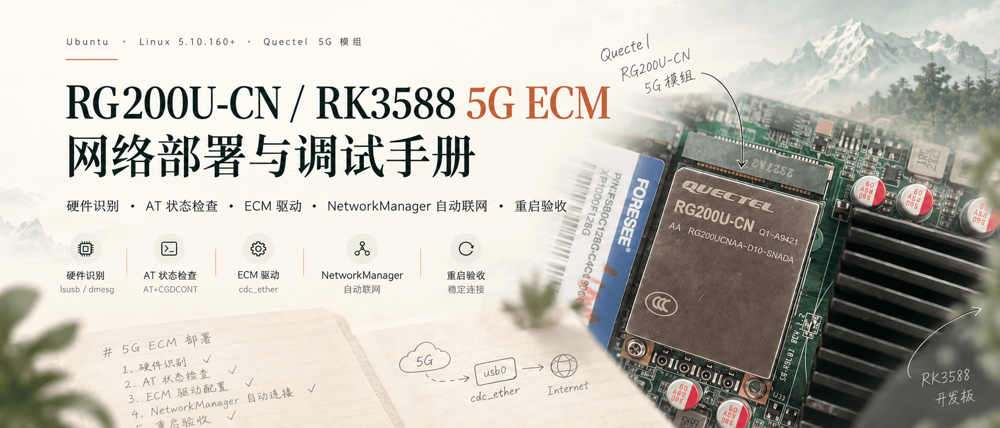

本文整理自《RG200U-CN / RK3588 5G ECM 网络部署与验收手册》和 `5G.md` 调试笔记。前者提供已验收的 ECM 部署流程，后者补充 AT 命令、状态响应和探索记录。

> 原始记录日期为 2026年10月10日，文章整理日期为 2026年10月12日。下文“本机”指原始手册中的设备，联网结果沿用该记录；本文整理过程中没有重新操作硬件。

ECM 是通过 USB 提供以太网接口的通信方式。在这套环境里，模组侧负责蜂窝数据链路，Linux 侧通过 `cdc_ether` 驱动得到 `usb0`，再由 NetworkManager 管理地址、DNS 和自动连接。



*配图为主题示意图，用于概览硬件识别、AT 检查、ECM 驱动、自动联网与重启验收，不作为现场测试证据。*

### 调试目标与适用环境

> **版本**：v1.0（2026-10-10）  
> **适用场景**：RK3588，Ubuntu，Linux 5.10.160+，移远 RG200U-CN（本机 USB ID `2c7c:0900`），使用 `cdc_ether` 提供的 ECM 网卡 `usb0`；NetworkManager 1.22.10、ModemManager 1.18.6。  
> **目标**：保留 `eth0` 的局域网 SSH；让 NetworkManager 独立管理 `usb0`，开机自动 DHCP 获取 IPv4/网关，并持久化 DNS；重启后自动连通 5G。  
> **状态**：本机已完成**重启后自动连接和公网通信验证**；断网自愈、SIM 注册异常自愈、长时间稳定性尚未验证。

## 1. 已验收的最终结果（示例地址不要照抄）


| 项目 | 本机验证结果 |
|---|---|
| `eth0` 局域网 SSH | `192.168.31.179/24`；Windows 发起端 `192.168.31.166`；SSH 回程走 `eth0` |
| RG200U-CN USB ID | `2c7c:0900` |
| ECM 驱动 | `cdc_ether` |
| 数据网口 | `usb0`，MAC `4a:b2:7e:7d:43:a2` |
| DHCP 地址 | `10.166.8.137/24`（仅示例，每台按实际 DHCP） |
| DHCP 网关 | `10.166.8.1`（按实际下发） |
| DNS | `119.29.29.29`、`223.5.5.5`（NetworkManager 连接固定 DNS） |
| NetworkManager 配置名 | `RG200U-5G-ECM` |
| IPv4 路由 metric | 500；注意与其他网络接口路由优先级关系 |
| ModemManager | 服务可运行，但 `mmcli -L` 对该模组显示 `No modems were found`（按本方案预期） |
| 重启后 | `usb0 ethernet 已连接 RG200U-5G-ECM`；IP / DNS 自动恢复 |
| 公网检测 | `ping -4 -I usb0 -c 4 119.29.29.29` 成功 4/4；`ping -4 -I usb0 -c 4 baidu.com` 成功 4/4 |

**重要区别**：`AT+CMEE=2` 只设置 AT 命令错误提示格式，**不是**激活 5G 网络的必要开关；`AT+CGACT=1,1` 是激活 CID 1 的数据上下文，执行前应检查 SIM、APN、注册和数据会话当前状态；`AT+CGPADDR=1` 用于查询模组侧 PDP/PDU 会话地址，而 `ip -4 addr show usb0` 是查询 Linux ECM 侧 DHCP 地址，两者不一定相同。

---


## 2. 硬件识别与串口准备


```bash
uname -a
lsusb | grep -iE '2c7c|Quectel'
lsusb -t
ip -br link
ls -l /dev/ttyUSB*
lsmod | grep -E 'cdc_ether|usbnet|option' || true
readlink -f /sys/class/net/usb0/device/driver
systemctl is-active NetworkManager
systemctl is-active ModemManager
```

确认：
1. `lsusb` 中出现 `2c7c:0900`（若不同，先核对模组型号、USB 枚举、固件，**不要直接照抄 VID/PID 规则**）。
2. Linux 中出现 `usb0`，对应驱动 `cdc_ether`。驱动内建时 `lsmod` 可能不显示，以 sysfs 路径为准。
3. 有可用 AT 端口（本机曾使用 `/dev/ttyUSB2`；其他设备端口号可能不同）。
4. 当前 SSH 若来自 `eth0`，先执行 `echo "$SSH_CONNECTION"; ip route get <SSH客户端IP>`，确保后续保留管理通道。

> 若 `lsusb` 都没有 RG200U，请先排查供电、启动时序、Mini PCIe/USB 布线、USB 速率协商；这不是 DHCP 或 NetworkManager 的问题。


### 串口选择与占用排查

原始笔记也使用过 `/dev/ttyUSB3`。端口号由设备实际枚举决定，不应直接把另一台设备的编号照搬过来。

```bash
busybox microcom  /dev/ttyUSB3

sudo busybox microcom  /dev/ttyUSB2
```

先查看占用进程，再判断是否需要停止对应串口工具。`fuser -k` 会结束占用进程，`-9` 会强制结束；这两条属于原始排障记录，不是每次调试的必做步骤。

```bash
sudo fuser /dev/ttyUSB2

sudo fuser -k /dev/ttyUSB2

sudo fuser -k -9 /dev/ttyUSB2
```

笔记中的 USB 工具安装命令如下，已安装时无需重复执行：

```bash
sudo apt install -y usbutils
sudo update-usbids
```

## 3. AT 状态检查与响应判读


本机使用：

```bash
sudo busybox microcom /dev/ttyUSB2
```

根据另一台设备实际 AT 端口调整。进入串口后逐条发送（**以下是 AT 命令，不是在 Linux Shell 中执行**）：

```text
AT
AT+CMEE=2
AT+CPIN?
AT+CSQ
AT+C5GREG?
AT+CGATT?
AT+CGDCONT?
AT+CGACT?
AT+CGPADDR=1
AT+QNWINFO
```

判读：
- `AT` -> `OK`：AT 端口正常。
- `AT+CMEE=2`：启用详细错误码/错误描述，有助排错；不负责拨号或上网。
- `AT+CPIN?` -> `+CPIN: READY`：SIM 可用。
- `AT+CSQ`：查看基本信号质量，数值因网络和模组而异。
- `AT+C5GREG?`：确认 5G 注册状态；本机曾出现 `+C5GREG: 0,1`（已注册本地网络）。
- `AT+CGATT?` -> `+CGATT: 1`：分组域已附着。
- `AT+CGDCONT?`：确认 CID 1 的 APN；本机为 `cmnet`，PDP 类型 `IPV4V6`。不同 SIM/运营商应使用实际正确 APN。
- `AT+CGACT?`：列出各 CID 的激活状态；重点检查 `+CGACT: 1,1`。
- `AT+CGPADDR=1`：查询 CID 1 的模组侧地址；本机曾查询到私网地址 `10.134.46.148`，与 `usb0` 的 DHCP 地址 `10.166.8.137` **不是同一个概念**。
- `AT+QNWINFO`：查看当前网络制式/频段；本机曾为 `NR5G-SA`、N41。

**若 CID 1 未激活，且已确认 SIM、APN、注册和附着正常**，可以手动执行：

```text
AT+CGACT=1,1
AT+CGACT?
AT+CGPADDR=1
```

预期看到 `+CGACT: 1,1` 以及 CID 1 地址。此操作会改变蜂窝数据上下文，请不要在正在承载远程业务的在线链路上无计划执行。**如果 CID 1 已激活，应跳过 `AT+CGACT=1,1`**。若出现 `ERROR` 或 `+CME ERROR`，先检查 APN/SIM/注册，不要无限重试。

> 另一台设备是否需要手动 `AT+CGACT=1,1`，必须以实际开机状态为准。本机最终的开机联网测试没有证明所有 SIM/固件组合都无需 AT 激活。串口终端退出方式以工具实现为准，避免长期占用 AT 端口。


### 原始笔记中的网络状态响应

以下响应来自 `5G.md`。这组记录显示 SIM 所在网络已注册、分组域已附着，并记录了 APN、激活状态和 N41 频段信息。它与手册中的 DHCP 地址记录来自不同检查时刻，不能要求所有地址完全相同。

```text
at+csq
+CSQ: 23,99

OK
at+c5greg?
+C5GREG: 0,1

OK
at+cgatt?
+CGATT: 1

OK
at+cgdcont?
+CGDCONT: 1,"IPV4V6","cmnet","0.0.0.0",0,0,0,0,,,,,,0,,,0,,0,0,0,0
+CGDCONT: 11,"IPV4V6","ims","0.0.0.0",0,0,0,2,,,,,,0,,,0,,0,0,0,0

OK
at+cgact?
+CGACT: 1,1
+CGACT: 11,1

OK
at+cgpaddr=1
+CGPADDR: 1,"10.116.144.184","2409:8947:01b2:1219:18dd:12fa:c5a3:05f5"

OK
at+qnwinfo
+QNWINFO: "NR5G-SA",46000,"NR N41",504990

OK
```

## 4. USB 网络模式与拨号命令

这一节补充原始探索笔记中的命令含义，不替代后面的已验收 ECM 主线。切换网络模式和重启模组会影响正在使用的链路，应先确认本机型号、固件和恢复通道。

根据[移远 RGx00U / RM500U 系列 AT 命令手册 V1.0](https://quectel.com/content/uploads/2024/02/Quectel_RGx00URM500U_Series_AT_Commands_Manual_V1.0.pdf)第 3.3.1、3.3.2 节，USB 网络参数对应关系如下：

| 参数 | USB 网络类型 |
| --- | --- |
| `1` | ECM |
| `2` | MBIM |
| `3` | RNDIS |
| `5` | NCM |

不带参数的 `AT+QCFG="usbnet"` 查询当前设置；带参数时修改设置，重启模组后生效。原笔记中的 `MBIN` 应理解为 `MBIM`，附录仍保留原始拼写。

同一手册将 `nat` 的 `0`、`1`、`2` 分别定义为网卡模式、路由模式和网桥模式。这些是备选配置，不应依次发送全部设置。

### 两组拨号参数的区别

手册第 9.16 节给出的格式为 `AT+QNETDEVCTL=<cid>[,<op>,<state>]`。`1,3,1` 表示使用 CID 1、发起并保存拨号配置、开启断网后的重新拨号；`3,1,1` 使用的是 CID 3，且不保存拨号配置。两组参数不能互换。具体支持范围以实际固件为准。[查看官方定义](https://quectel.com/content/uploads/2024/02/Quectel_RGx00URM500U_Series_AT_Commands_Manual_V1.0.pdf#page=203)。

原始笔记里的 `AT+QNETDEVSTATUS?`、`AT+QCFG="usbnet",0`、`AT+QCFG="usbnet",4` 等探索输入保留在附录。此版手册使用 `AT+QNETDEVSTATUS=<cid>` 查询指定上下文，也没有把 `0`、`4` 列为上述 USB 网络类型；因此不把这些旧输入纳入已验证步骤。

### 关机与重启说明

原笔记将 `at+qpowd` 写成“重启模块”。官方手册第 12.1 节定义它为关机命令，应等待 `POWERED DOWN` 后按硬件要求处理供电，不把它当作普通重启命令。[查看官方说明](https://quectel.com/content/uploads/2024/02/Quectel_RGx00URM500U_Series_AT_Commands_Manual_V1.0.pdf#page=243)。

原始的 `AT+CGDCONT=AT+CFUN`、`at+c5reg`、`AT+WS46=` 和孤立的 `AT+` 缺少足够上下文，属于疑似不完整输入；完整记录在附录中保留，不擅自补写或推荐执行。

## 5. 让 NetworkManager 独立识别 ECM


**实施前确认**：有稳定的 `eth0` SSH 连接，最好有本地显示器/串口控制台作为回退通道。此规则会让 ModemManager **忽略整台**指定 USB ID 的调制解调器，影响 `mmcli` 管理功能；但 Linux `option`、`cdc_ether` 等内核驱动仍可提供串口及网卡接口。

备份：

```bash
sudo mkdir -p /root/network-backup
sudo cp -a /etc/NetworkManager /root/network-backup/
sudo cp -a /etc/udev/rules.d /root/network-backup/
```

若旧设备已有之前的端口级测试规则 `99-rg200u-ecm.rules`，将其禁用（新设备可跳过）：

```bash
if [ -f /etc/udev/rules.d/99-rg200u-ecm.rules ]; then
  sudo mv /etc/udev/rules.d/99-rg200u-ecm.rules \
    /etc/udev/rules.d/99-rg200u-ecm.rules.disabled
fi
```

创建 **本机已经成功验证** 的规则：

```bash
sudo tee /etc/udev/rules.d/78-mm-rg200u-ignore.rules > /dev/null <<'EOF_UDEV'
# RG200U-CN - ECM managed by NetworkManager
# Vendor 2c7c / Product 0900

ACTION!="add|change|move|bind", GOTO="rg200u_end"

SUBSYSTEM=="net", ATTRS{idVendor}=="2c7c", ATTRS{idProduct}=="0900", ENV{ID_MM_DEVICE_IGNORE}="1"

SUBSYSTEM=="tty", ATTRS{idVendor}=="2c7c", ATTRS{idProduct}=="0900", ENV{ID_MM_DEVICE_IGNORE}="1"

LABEL="rg200u_end"
EOF_UDEV
```

先做**模拟验证**（不会让现有设备自动重新探测）：

```bash
sudo udevadm test /sys/class/net/usb0 2>&1 | grep 'ID_MM_DEVICE_IGNORE'
sudo udevadm test /sys/class/tty/ttyUSB2 2>&1 | grep 'ID_MM_DEVICE_IGNORE'
```

预期均输出 `ID_MM_DEVICE_IGNORE=1`（按实际 AT 端口替换 ttyUSB2）。

**注意**：`udevadm test` 测试成功 ≠ 网络已经切换；`udevadm control --reload-rules` 只重载规则，不重新发现已存在的网络设备。

在本地可恢复条件下再执行：

```bash
sudo udevadm control --reload-rules
sudo reboot
```

重启后应看到：

```bash
nmcli device status
mmcli -L
udevadm info -q property -p /sys/class/net/usb0 | grep ID_MM_DEVICE_IGNORE
```

**本机成功状态**：`nmcli device status` 包含 `usb0 ethernet`；`mmcli -L` 返回 `No modems were found`；此时属于设备级过滤生效的正常表现。若重启后仍不显示 `usb0`，停止后续配置，先分析 NetworkManager / ModemManager 的日志。


## 6. DHCP、固定 DNS 与自动连接


对于**全新调试设备**，先检查是否已经存在：

```bash
nmcli connection show
```

如果没有 `RG200U-5G-ECM`，创建：

```bash
sudo nmcli connection add \
  type ethernet \
  ifname usb0 \
  con-name RG200U-5G-ECM \
  connection.autoconnect no \
  ipv4.method auto \
  ipv4.dns "119.29.29.29 223.5.5.5" \
  ipv4.ignore-auto-dns yes \
  ipv4.route-metric 500 \
  ipv6.method disabled
```

> `ipv4.method auto` = 自动获取 IPv4/网关；这里的 DNS **不是 DHCP 自动下发**，而是通过 NetworkManager 固定写入。若希望跟随运营商 DHCP 的 DNS，应单独测试 `ipv4.ignore-auto-dns no` 并移除固定 DNS，不能认为两种方案相同。

如果连接已经存在，只检查配置，避免重复创建：

```bash
nmcli -f connection.id,connection.interface-name,connection.autoconnect,ipv4.method,ipv4.dns,ipv4.ignore-auto-dns,ipv4.route-metric connection show RG200U-5G-ECM
```

确认 SSH 回程路由正确：

```bash
# 按 SSH 客户端真实 IP 替换，不要机械照抄
ip route get 192.168.31.166
```

本机预期 `dev eth0 src 192.168.31.179`。**本次验证场景的 SSH 客户端与 eth0 在同一 `/24` 网段**；跨网段 SSH 时要进一步分析回程路由和策略路由。

在能恢复现场的情况下，激活连接：

```bash
sudo nmcli connection up RG200U-5G-ECM ifname usb0
```

验证：

```bash
nmcli device status
nmcli device show usb0
ip -4 addr show usb0
ip -4 route
resolvectl status usb0
ping -4 -I usb0 -c 4 119.29.29.29
ping -4 -I usb0 -c 4 baidu.com
```

确认 `usb0` 已连接、取得 IPv4、DNS 生效、公网 IP 和域名均可到达后，设置开机自动连接：

```bash
sudo nmcli connection modify RG200U-5G-ECM connection.autoconnect yes
nmcli -g connection.autoconnect connection show RG200U-5G-ECM
```

预期输出 `yes`。


## 7. 重启验收与实际结果


在有备用恢复能力时重启：

```bash
sudo reboot
```

重新通过 eth0 SSH 连接，**不要先执行 `nmcli connection up`**，直接验证：

```bash
nmcli device status
ip -4 addr show usb0
resolvectl status usb0
ip -4 route
ip route get 192.168.31.166
ping -4 -I usb0 -c 4 119.29.29.29
ping -4 -I usb0 -c 4 baidu.com
```

**本机最终实际已通过**：重启后 `usb0 ethernet 已连接 RG200U-5G-ECM`；IPv4 `10.166.8.137/24`；DNS `119.29.29.29` 和 `223.5.5.5`；两组公网 ping 都为 4 发 4 收。此时可判定**开机自动 ECM DHCP / 固定 DNS / IPv4 联网**通过。


## 8. 第二台设备的复用流程


1. **保留 SSH 管理通路**：先核对 `eth0` IP、当前 SSH 客户端地址及 `ip route get`。
2. **确认硬件一致性**：RG200U-CN、实际 USB ID `2c7c:0900`、`cdc_ether` 和 `usb0`。若不一致，停止照搬。
3. **检查 AT 状态**：`AT+CMEE=2`（可选调试）、`AT+CPIN?`、`AT+C5GREG?`、`AT+CGATT?`、`AT+CGDCONT?`、`AT+CGACT?`、`AT+CGPADDR=1`；仅在 CID 1 未激活且前提正常时执行 `AT+CGACT=1,1`，再复查。
4. **应用设备级 udev 规则**：`/etc/udev/rules.d/78-mm-rg200u-ignore.rules`；模拟测试通过后，在可恢复条件下重启并确认 `usb0` 显示在 `nmcli` 中。
5. **创建/检查 NetworkManager 连接**：ECM `usb0`、DHCP、固定 DNS、metric 500，先 `autoconnect no`，测试成功再开启 `yes`。
6. **完成 IPv4 / DNS / 路由 / SSH 测试**，保留完整日志。
7. **必须重启验收**：不手动执行连接命令，检查 `usb0` 自动激活及公网连通性。
8. **后续单独做可靠性测试**：SIM 卡异常、蜂窝网络中断恢复、USB 重枚举、长期运行、DHCP 租约续期及远程 VPS SSH。

### 一次性验收命令（只读，不修改网络）

```bash
printf '\n=== USB device ===\n'; lsusb | grep -iE '2c7c|Quectel'
printf '\n=== net interfaces ===\n'; ip -br addr
printf '\n=== NM ===\n'; nmcli device status
printf '\n=== autoconnect ===\n'; nmcli -g connection.autoconnect connection show RG200U-5G-ECM
printf '\n=== modem list ===\n'; mmcli -L
printf '\n=== DNS ===\n'; resolvectl status usb0
printf '\n=== routes ===\n'; ip -4 route
printf '\n=== SSH path ===\n'; echo "$SSH_CONNECTION"
printf '\n=== direct IP test ===\n'; ping -4 -I usb0 -c 4 119.29.29.29
printf '\n=== domain test ===\n'; ping -4 -I usb0 -c 4 baidu.com
```


### 成功配置清单


**关键文件：** `/etc/udev/rules.d/78-mm-rg200u-ignore.rules`  
**关键 NetworkManager 配置：** `RG200U-5G-ECM`，`ifname usb0`，`ipv4.method auto`，`ipv4.dns 119.29.29.29 223.5.5.5`，`ipv4.ignore-auto-dns yes`，`ipv4.route-metric 500`，`connection.autoconnect yes`。  
**关键 AT 检查：** `AT+CMEE=2`（调试可选）→ `AT+CGACT?` → 如 CID 1 未激活且注册正常则 `AT+CGACT=1,1` → `AT+CGACT?` → `AT+CGPADDR=1`。  
**最终验收**：重启后 `nmcli device status` 显示 `usb0 ethernet 已连接`，`ip -4 addr show usb0` 有动态地址，`resolvectl status usb0` 有正确 DNS，IP 和域名 ping 均成功，`eth0` SSH 不中断。


## 9. 回滚与调试注意事项


### A. 停用 ECM 连接自动启动（不会立即断网）

```bash
sudo nmcli connection modify RG200U-5G-ECM connection.autoconnect no
```

### B. 撤销设备级忽略规则（本地控制台操作）

```bash
sudo mv /etc/udev/rules.d/78-mm-rg200u-ignore.rules \
  /etc/udev/rules.d/78-mm-rg200u-ignore.rules.disabled
sudo udevadm control --reload-rules
# 由现场人员在可恢复条件下重启，使端口重新探测
```

恢复后 `mmcli -L` 可能再次识别到 RG200U-CN，而 NetworkManager 可能失去独立 `usb0` 设备；因此不要把回滚当作维持现有 5G 网络不断线的操作。

### C. 边界与长期运行风险

- `ID_MM_DEVICE_IGNORE=1` **屏蔽整个 RG200U-CN 在 ModemManager 中的探测**，而不只是网络口；`mmcli` 将不能用于该模组的常规管理。AT 串口设备通常仍存在，可用串口工具与模组通信。
- `AT+CGACT=1,1` 并非通用开机自动拨号脚本，不宜未经状态判断就放入 systemd 自动执行；后续要做状态机/故障恢复策略。
- DHCP 地址及默认网关由模组提供，每台设备可能不同；不能将 `10.166.8.137`、`10.166.8.1` 写死。
- `usb0` 的默认路由 metric 500 比本机 `eth0` 的 999999 低，所以一般公网 IPv4 优先经 5G；若 SSH 来自其他网段，存在回程路由风险，需要专门设计。
- 5G 网卡私网地址不等于公网可入站地址。跨互联网远程 SSH 通常还需要 VPS + WireGuard / 反向 SSH 等方案。
- 此文档对**同型号、同模式、同系统栈**具有参考价值；换 SIM/固件、USB 组合模式、接口名、NetworkManager 或 ModemManager 版本，要先重新核实兼容性。


## 10. 命令速查与原始调试记录

### 常用查询速查

| 命令 | 中文说明 |
| --- | --- |
| `AT+CPIN?` | 检查 SIM 是否就绪 |
| `AT+CSQ` | 查看基本信号质量 |
| `AT+C5GREG?` | 查看 5G 注册状态 |
| `AT+CGATT?` | 查看分组域附着状态 |
| `AT+CGDCONT?` | 查看数据上下文与 APN |
| `AT+CGACT?` | 查看上下文激活状态 |
| `AT+CGPADDR=1` | 查询 CID 1 的模组侧地址 |
| `AT+QNWINFO` | 查看当前网络制式和频段 |
| `AT+COPS?` | 查看运营商与选网状态 |
| `AT+QCFG="usbnet"` | 查询当前 USB 网络模式 |
| `AT+QNETDEVSTATUS=1` | 按官方手册查询 CID 1 的 USB 网络状态，需核对固件支持 |
| `nmcli device status` | 查看主机接口与连接状态 |
| `ip -4 addr show usb0` | 查看 ECM 接口的 IPv4 地址 |
| `resolvectl status usb0` | 查看接口的 DNS 配置 |

### EC20F 历史日志与未验证的探索输入

下面完整保留 `5G.md` 的原始记录顺序，其中 EC20F 属于其他型号的历史日志，不作为 RG200U 的实测结果。IMEI 已隐藏，其余命令与输出保留原始拼写。未验证或疑似不完整输入只用于回顾调试过程，修正说明见第 4 节。

<details>
<summary>展开完整原始调试笔记</summary>

```text
busybox microcom  /dev/ttyUSB3

sudo busybox microcom  /dev/ttyUSB2


执行 AT+QCFG="usbnet",5 配置网卡拨号方式及驱动类型为 NCM；
        或者执行 AT+QCFG="usbnet",1 配置网卡拨号方式及驱动类型为 ECM；
        或者执行 AT+QCFG="usbnet",2 配置网卡拨号方式及驱动类型为 MBIM；
        或者执行 AT+QCFG="usbnet",3 配置网卡拨号方式及驱动类型为 RNDIS。

        执行 AT+QCFG="nat",0 配置拨号模式为网卡模式；
        或者执行 AT+QCFG="nat",1 配置拨号模式为路由模式；
        或者执行 AT+QCFG="nat",2 配置拨号模式为网桥模式。
注意：使用 AT+QCFG="usbnet",2 5G 拨号方式时候，没有配置拨号模式也可以上网。
3.2标准过程
拨号方式和驱动类型
AT+QCFG="usbnet",3 1接口类型为ECM, 2接口MBIM, 3接口类型为RNDIS, 5接口类型为NCM
AT+QCFG="nat",0配置网卡模式 （5G模组可选）
AT+QCFG="ethernet",1开启网卡（可选）
以上3个指令设置后AT+CFUN=1,1重启模块，（最好断电重启设备）再发以下指令拨号模式
AT+QICSGP=1,1,"" 重启后接着发送指令
AT+QNETDEVCTL=1,3,1 执行拨号 关键的一步
通过 AT+QCFG="usbnet" 查询网卡拨号方式及驱动类型，查询当前配置
LINUX可用: ECM NCM RNDIS MBIM （根据型号不同，使用不同的模式。5G 常用 MBIM）
WINDOWS: MBIN


at+cpin?

AT+QCFG="usbnet",1
AT+QCFG="usbnet",3
AT+QCFG="usbnet",5
AT+QCFG="nat",0
AT+QCFG="ethernet",1
以上3个指令设置后AT+CFUN=1,1重启模块，再发以下指令拨号
AT+QNETDEVCTL=1,3,1

AT+QCFG="usbnet",0

AT+QCFG="usbnet",1

AT+QCFG="usbnet",4

AT+QNETDEVCTL=3,1,1

at+cgpaddr

at+qping=1,"baidu.com"

at+cgreg=?

at+cgreg=1

at+c5reg


AT
AT+QCFG="usbnet"
AT+CGDCONT?
AT+QNETDEVSTATUS?

然后启动 USB 网络数据通道：

AT+QNETDEVCTL=1,3,1

at+cfun=0 飞行模式

at+cfun=1  找网模式

at+qpowd  重启模块

at+qicsgp=1   查询模块当前的APN，用户名，密码

at+cgdcont?  查询模块当前的APN，网络协议

at+cpin? 查询是否读到卡

at+csq  查询模块射频信号值

at+qeng="servingcell"  查询注册的主基站信息

at+cgpaddr  查询模块是否获取到IP

at+cgreg? 查询模块注网状态PS域（数据业务）

at+qnwinfo   查询模块当前的网络制式和频段信息

at+cops? 查询运营商以及模组注网情况


AT+
EC20CEHDLGR06A07M1G

OK
AT+CGSN
[IMEI 已隐藏]

OK
ATI
Quectel
EC20F
Revision: EC20CEHDLGR06A07M1G

OK
AT*CNTI=2
*CNTI: 2, GSM, GPRS, EDGE, UMTS, HSDPA, HSUPA

OK
AT+WS46=
+WS46: (12,22,25,28,29)

OK
AT+CGDCONT=AT+CFUN
+CFUN: 1

OK
AT+CPIN?
+CPIN: READY


AT
AT+CMEE=2
ATI
AT+CGMM
AT+CPIN?
AT+QCCID
AT+CIMI
AT+QSIMSTAT?
AT+QCFG="usbnet"

sudo apt install -y usbutils
sudo update-usbids


AT+CMEE=2
AT+CPIN?
AT+QSIMSTAT?
AT+QSIMDET?
AT+CFUN?
AT+QCFG="usbnet"


AT+CSQ
AT+CEREG?
AT+CGREG?
AT+COPS?


###### 查看哪个进程占用了该设备

sudo fuser /dev/ttyUSB2

###### 强制杀死占用进程

sudo fuser -k /dev/ttyUSB2

###### 或者用更强制的方式

sudo fuser -k -9 /dev/ttyUSB2


sudo nmcli connection add \
  type ethernet \
  ifname usb0 \
  con-name RG200U-5G-ECM \
  connection.autoconnect no \
  ipv4.method auto \
  ipv4.dns "119.29.29.29 223.5.5.5" \
  ipv4.ignore-auto-dns yes \
  ipv4.route-metric 500 \
  ipv6.method disabled
  
  
at+csq
+CSQ: 23,99

OK
at+c5greg?
+C5GREG: 0,1

OK
at+cgatt?
+CGATT: 1

OK
at+cgdcont?
+CGDCONT: 1,"IPV4V6","cmnet","0.0.0.0",0,0,0,0,,,,,,0,,,0,,0,0,0,0
+CGDCONT: 11,"IPV4V6","ims","0.0.0.0",0,0,0,2,,,,,,0,,,0,,0,0,0,0

OK
at+cgact?
+CGACT: 1,1
+CGACT: 11,1

OK
at+cgpaddr=1
+CGPADDR: 1,"10.116.144.184","2409:8947:01b2:1219:18dd:12fa:c5a3:05f5"

OK
at+qnwinfo
+QNWINFO: "NR5G-SA",46000,"NR N41",504990

OK
```

</details>

### 资料来源

- 本地部署手册：`docs/RG200U-CN_RK3588_5G_ECM_部署调试手册.md`，v1.0，2026年10月10日。
- 本地调试笔记：`docs/5G.md`。

- [移远官方 RGx00U / RM500U 系列 AT 命令手册 V1.0](https://quectel.com/content/uploads/2024/02/Quectel_RGx00URM500U_Series_AT_Commands_Manual_V1.0.pdf)：用于核对网络模式、拨号参数和关机命令。
