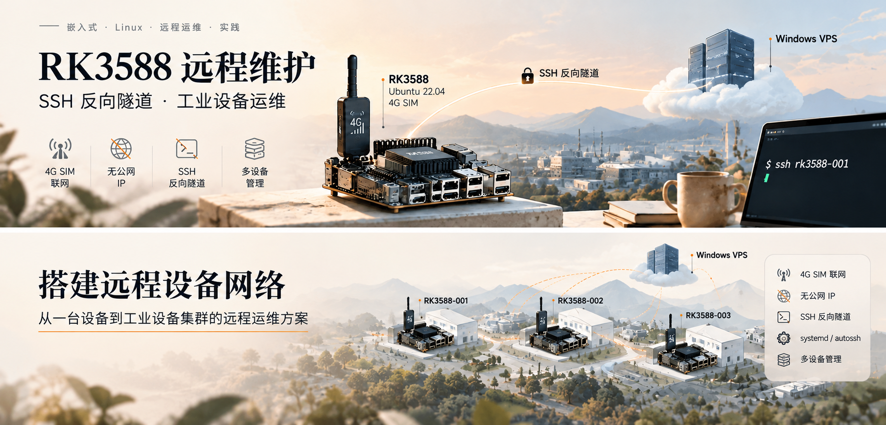
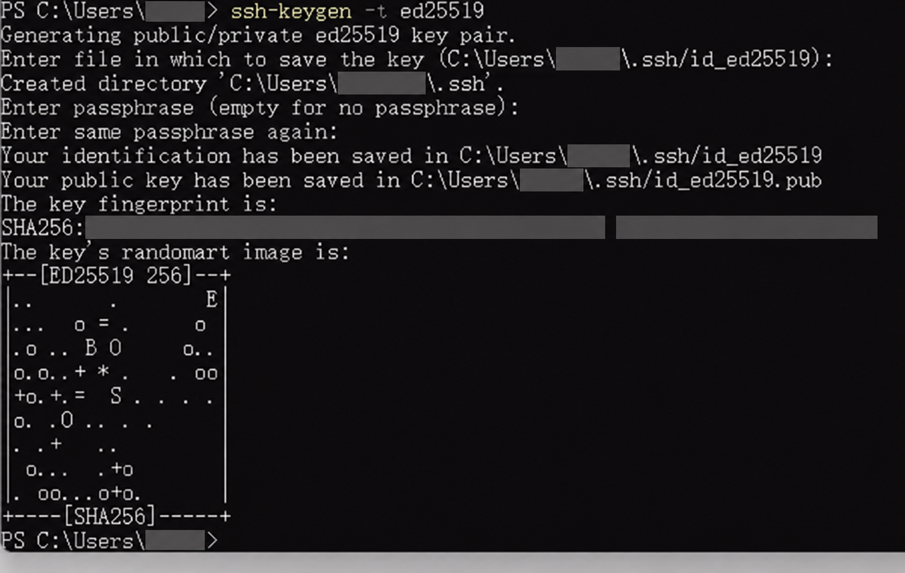
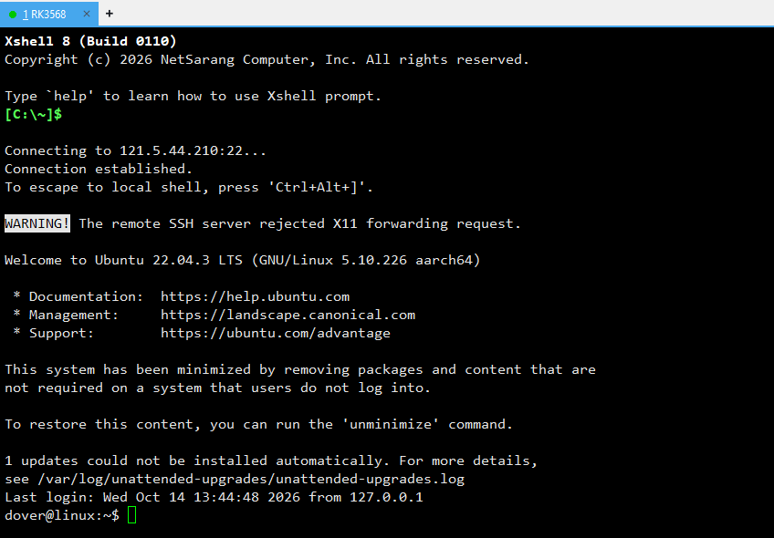

工业现场的 RK3588 通过 4G SIM 卡联网时，通常无法从管理电脑直接发起 SSH 连接。原始教程用一台有公网地址的 Windows VPS 接收设备主动建立的反向隧道，最终通过 `ssh rk3588-001` 进入设备。

本文沿用“搭建 VPN”的标题，具体实现是 **SSH 反向 TCP 隧道与跳板访问**，提供设备 SSH 的远程维护入口。原资料没有配置虚拟网卡、全网段互通或全流量 VPN；需要访问其他服务时，应另行规划转发和授权。

> 本文整理于 2026年10月15日，原始截图日期为 2026年10月14日。内容来自提供的教程和截图，没有重新登录 VPS 或设备进行实机验证。下文补充的命令是推荐检查步骤，重启上线、断线重连及长期稳定性仍需在自己的环境验收。

## 1. 目标、环境与替换参数

| 角色 | 本文示例 | 作用 |
| --- | --- | --- |
| 管理电脑 | Windows PowerShell / OpenSSH 客户端 | 登录 VPS，并通过跳板访问设备 |
| 公网中转服务器 | Windows VPS，SSH 端口 22 | 接收设备连接，监听反向转发端口 |
| 现场设备 | RK3588，Ubuntu 22.04，4G SIM | 主动建立 SSH 反向隧道 |
| 设备账号 | `dover` | RK3588 登录用户及 systemd 服务用户 |
| VPS 示例账号 | `administrator` | 原稿使用的 Windows 管理员账号 |

正文中的 `VPS_PUBLIC_IP` 是**必须替换的占位主机名**，不是 Shell 自动展开的变量。把它替换为自己的 VPS IP 或域名；`administrator`、`dover`、密钥路径和设备编号也要核对。附录中的 `121.5.44.210` 来自原稿，仅供对照，不能当作公共测试服务器。

管理员账号沿用原教程，生产环境可进一步按设备拆分专用账户及转发权限。本文的默认前提是 VPS 和设备均为自己有权维护的机器，且设备已经能够联网。

## 2. 连接架构与端口规划



*方案图由提供的主题插画整理，中文化说明并移除无关品牌；它展示连接思路，不代表实时设备状态。*

```text
RK3588-001 --主动 SSH--> Windows VPS:22
    本机 127.0.0.1:22 <--反向隧道-- VPS 127.0.0.1:22001

管理电脑 --SSH 跳板--> Windows VPS --连接回环 22001--> RK3588-001
```

| 设备 | VPS 回环监听 | 隧道最终目标 |
| --- | --- | --- |
| RK3588-001 | `127.0.0.1:22001` | 001 本机 `127.0.0.1:22` |
| RK3588-002 | `127.0.0.1:22002` | 002 本机 `127.0.0.1:22` |
| RK3588-003 | `127.0.0.1:22003` | 003 本机 `127.0.0.1:22`，扩展示例 |

设备通过自己的蜂窝网络发起出站 SSH，不要求 SIM 获得可供外部访问的公网 IP。管理电脑先认证 VPS，再认证目标 RK3588；两个认证过程分别检查各自的账户和主机密钥。

## 3. Windows VPS：安装与配置 OpenSSH

### 安装服务并检查入口

以下命令在 **Windows VPS 的管理员 PowerShell** 中执行。已安装时先检查状态，无需重复安装：

```powershell
Get-WindowsCapability -Online -Name 'OpenSSH.Server*'
Add-WindowsCapability -Online -Name OpenSSH.Server~~~~0.0.1.0
Start-Service sshd
Set-Service sshd -StartupType Automatic
Get-Service sshd
```

同时核对 Windows 防火墙的 `OpenSSH-Server-In-TCP` 规则和云安全组：本方案需要允许合法管理端与设备访问 VPS 的 TCP 22。若规则不存在，参照当前 Windows 版本的安装流程建立规则，再按实际来源收敛访问范围。[Windows 安装与防火墙说明](https://learn.microsoft.com/en-us/windows-server/administration/openssh/openssh_install_firstuse)。

**不需要将 22001、22002、22003 开放为公网入站端口。** 它们只供 VPS 本机和已认证的 SSH 跳板连接使用。

### 配置转发与检查语法

先备份并编辑 `C:\ProgramData\ssh\sshd_config`。下面是全局设置；放在第一个 `Match` 段之前，修改现有对应项，避免只追加到不适用的账号匹配段：

```conf
PubkeyAuthentication yes
AllowTcpForwarding yes
GatewayPorts no
AllowAgentForwarding no
```

主线使用回环监听。原稿的 `GatewayPorts yes` 会让远程转发采用通配地址监听，与图中的 localhost 访问范围不同；这里改为 `no`。保留 TCP 转发支持设备的反向连接和管理端跳板，不启用代理转发。[OpenSSH 服务端配置](https://man.openbsd.org/sshd_config)。

在 VPS 检查配置无误后重启服务；若 OpenSSH 安装路径不同，先定位 `sshd.exe`：

```powershell
& "$env:WINDIR\System32\OpenSSH\sshd.exe" -t -f "$env:ProgramData\ssh\sshd_config"
Restart-Service sshd
```

语法检查应没有错误输出。重启前保留 VPS 控制台或另一条管理通道，避免修改错误后失去入口；先验证新会话，再关闭旧会话。

## 4. 密钥放在哪里：三条认证关系

| 发起端 → 登录端 | 公钥应放的位置 | 私钥保留位置 |
| --- | --- | --- |
| 管理电脑 → VPS | VPS 对应 Windows 账号的授权文件 | 管理电脑 |
| RK3588 → VPS | VPS 授权文件，追加该设备的公钥 | 对应 RK3588 |
| 管理电脑 → RK3588 | RK3588 用户的 `~/.ssh/authorized_keys` | 管理电脑 |

**传输的是 `.pub` 公钥，不能把私钥复制到 VPS。** 两台 RK3588 分别生成自己的设备密钥；管理电脑访问设备可以先使用设备密码验证，再部署管理电脑公钥。

### 管理电脑生成密钥

先检查已有文件。存在时复用合适的密钥或换一个名称，不能在覆盖提示中直接确认：

```powershell
Test-Path "$env:USERPROFILE\.ssh\id_ed25519"
ssh-keygen -t ed25519
Get-Content "$env:USERPROFILE\.ssh\id_ed25519.pub"
```

Linux 管理端对应的公钥查看命令是 `cat ~/.ssh/id_ed25519.pub`。交互管理密钥可以设置口令，使用时由操作者或 ssh-agent 解锁。



*2026年10月14日原始密钥生成截图；仅展示生成过程，不包含私钥文件内容。个人标识已处理，终端输出保留原义。*

### VPS 的管理员授权文件

默认 Windows OpenSSH 管理员匹配规则使用 `C:\ProgramData\ssh\administrators_authorized_keys`；普通用户通常使用其用户目录下的 `.ssh\authorized_keys`。以实际 `sshd_config` 为准，管理员公钥不能仅按原稿 002 部分放入用户目录。[微软密钥认证说明](https://learn.microsoft.com/en-us/windows-server/administration/openssh/openssh_keymanagement)。

在 VPS 管理员 PowerShell 中**追加**一行公钥，然后检查 ACL。下面的 SID 避免本地化系统的组名差异：

```powershell
$publicKey = '粘贴完整的 ssh-ed25519 公钥行'
Add-Content -LiteralPath "$env:ProgramData\ssh\administrators_authorized_keys" -Value $publicKey -Encoding ascii
icacls "$env:ProgramData\ssh\administrators_authorized_keys" /inheritance:r
icacls "$env:ProgramData\ssh\administrators_authorized_keys" /grant:r "*S-1-5-18:F" "*S-1-5-32-544:F"
icacls "$env:ProgramData\ssh\administrators_authorized_keys"
```

替换 `$publicKey` 后再执行。最终只应由 SYSTEM 和 Administrators 访问；若原文件已有其他显式授权，先检查并按需撤销，不能认为去掉继承就会自动清除它们。每个公钥占一行，追加前检查是否已经存在。

管理电脑测试 VPS 登录并核对主机指纹：

```powershell
ssh -i "$env:USERPROFILE\.ssh\id_ed25519" administrator@VPS_PUBLIC_IP
```

首次连接时通过可信的 VPS 控制台核对主机公钥指纹，再接受保存；不要仅为跳过提示而关闭主机验证。

## 5. RK3588-001：先手动打通反向隧道

以下在 **001 的 dover 用户 Shell** 中执行。先检查本机 SSH 服务和网络：

```bash
sudo apt update
sudo apt install autossh openssh-server
sudo systemctl enable --now ssh
systemctl is-active ssh
ss -lnt | grep ':22'
ip route
```

生成独立的 VPS 连接密钥；已存在时检查并复用，不能覆盖：

```bash
test -f ~/.ssh/id_ed25519_vps && echo '密钥已存在，请先检查'
ssh-keygen -t ed25519 -f ~/.ssh/id_ed25519_vps
cat ~/.ssh/id_ed25519_vps.pub
```

把设备公钥追加到第 4 节的 VPS 授权文件。设备后台密钥必须有可用的无人值守解锁方式；本例没有为 systemd 配置 ssh-agent，若设置了密钥口令，应先解决服务解锁问题，不能指望后台弹出输入框。使用无口令的专用设备密钥时，要保护本机文件权限，并在 VPS 收敛对应账户的权限。

仍以 dover 身份先手动登录一次，核对并保存 VPS 主机指纹，然后确认非交互认证成功：

```bash
ssh -i ~/.ssh/id_ed25519_vps administrator@VPS_PUBLIC_IP
ssh -o BatchMode=yes -o StrictHostKeyChecking=yes -i ~/.ssh/id_ed25519_vps administrator@VPS_PUBLIC_IP hostname
```

`hostname` 应返回 VPS 名称，不应要求密码或首次指纹确认。这里认证的是 VPS，尚未验证 RK3588 的转发端口。

手动建立 001 隧道：

```bash
autossh -M 0 -N \
  -i /home/dover/.ssh/id_ed25519_vps \
  -o IdentitiesOnly=yes \
  -o BatchMode=yes \
  -o StrictHostKeyChecking=yes \
  -o ExitOnForwardFailure=yes \
  -o ServerAliveInterval=30 \
  -o ServerAliveCountMax=3 \
  -o ConnectTimeout=30 \
  -R 127.0.0.1:22001:127.0.0.1:22 \
  administrator@VPS_PUBLIC_IP
```

`-N` 只建立转发，不启动 VPS 交互 Shell；`-R` 左侧是 VPS 监听地址，右侧是设备侧目标。`-M 0` 关闭 autossh 独立监测端口，本例使用 SSH 保活；正常连接时窗口可能持续运行而没有输出。`ExitOnForwardFailure` 检查转发建立失败，不能代替目标服务检查。[SSH 参数](https://man.openbsd.org/ssh)、[autossh 项目说明](https://www.harding.motd.ca/autossh/)。

在 **VPS PowerShell** 中检查监听，再测试进入设备：

```powershell
Get-NetTCPConnection -State Listen -LocalPort 22001 | Select-Object LocalAddress,LocalPort,OwningProcess
ssh dover@127.0.0.1 -p 22001
```

监听应限定为 `127.0.0.1`，随后在设备 Shell 中用 `hostname`、`whoami`、`uname -a` 确认目标身份。VPS 到设备的临时测试可能需要设备密码，不能把“VPS 登录免密”误认为“设备登录也已免密”。

手动检查完成后，用 Ctrl+C 停止前台 autossh，再启动下一节服务，避免同一端口被两个进程占用。

## 6. systemd：开机自动上线

确认 `/home/dover` 是实际用户目录，并以同一用户完成上一节的认证。以 sudo 编辑 `/etc/systemd/system/autossh-rk3588.service`，使用下面的推荐配置；将 `VPS_PUBLIC_IP` 替换后再启动：

```ini
[Unit]
Description=RK3588 SSH reverse tunnel to Windows VPS
After=network-online.target ssh.service
Wants=network-online.target ssh.service

[Service]
Type=simple
User=dover
Environment="AUTOSSH_GATETIME=0"
ExecStartPre=/bin/bash -c 'until ip route | grep default; do sleep 5; done'
ExecStart=/usr/bin/autossh -M 0 -N \
    -i /home/dover/.ssh/id_ed25519_vps \
    -o IdentitiesOnly=yes \
    -o BatchMode=yes \
    -o StrictHostKeyChecking=yes \
    -o ExitOnForwardFailure=yes \
    -o ServerAliveInterval=30 \
    -o ServerAliveCountMax=3 \
    -o ConnectTimeout=30 \
    -R 127.0.0.1:22001:127.0.0.1:22 \
    administrator@VPS_PUBLIC_IP
Restart=always
RestartSec=15

[Install]
WantedBy=multi-user.target
```

保留原稿的网络依赖、默认路由等待和重启间隔。`network-online.target` 的效果依赖网络管理器的等待服务；默认路由存在也不代表蜂窝注册、DNS 或 VPS 连接已经可用。启动等待还受 systemd 超时控制，因此要结合实际联网时序查看日志。

在 RK3588 检查服务配置、启动并观察：

```bash
sudo systemd-analyze verify /etc/systemd/system/autossh-rk3588.service
sudo systemctl daemon-reload
sudo systemctl enable --now autossh-rk3588.service
systemctl status autossh-rk3588.service --no-pager
journalctl -u autossh-rk3588.service -n 100 --no-pager
```

服务应保持运行，并在 VPS 重新出现 22001 监听。最后仍需实际登录到设备；`active` 只是进程状态，不是完整的远程维护验收结果。

## 7. RK3588-002：新增一台设备

在 **002 上**执行第 5 节的安装和密钥步骤，生成自己的 `id_ed25519_vps`，把它的公钥追加到 VPS；不要复制 001 的私钥。先完成该设备用户的首次主机指纹确认与非交互认证。

002 使用相同服务文件名没有问题，因为文件位于另一台机器；在它自己的服务配置中将反向端口改为：

```text
-R 127.0.0.1:22002:127.0.0.1:22
```

用户和密钥目录不同也要一起修改。先手动测试，再启用服务：

```bash
sudo systemctl daemon-reload
sudo systemctl enable --now autossh-rk3588.service
systemctl status autossh-rk3588.service --no-pager
```

如果是在已经运行的服务上修改端口，还要执行 `sudo systemctl restart autossh-rk3588.service` 才会应用新参数。

在 **Windows VPS** 测试 002：

```powershell
Get-NetTCPConnection -State Listen -LocalPort 22002
ssh dover@127.0.0.1 -p 22002
```

用设备身份确认命令核对进入的是 002。接入 003 时依此分配 22003；原稿中的在线/离线表是管理示例，不是本文提供的实时监控。

## 8. 管理电脑：一个别名进入目标设备

原稿的 `RemoteCommand ssh rk3588-001` 会让 VPS 再执行这个别名，但没有给出 VPS 侧的同名配置。这里把跳板关系完整放在**管理电脑**的 SSH 配置中，不依赖 VPS 的 Shell 别名或私钥。

Windows 文件为 `$env:USERPROFILE\.ssh\config`；Linux/macOS 对应 `~/.ssh/config`。保留已有配置，将下面的具体 Host 段放在通用 `Host *` 默认项之前；已有同名段则合并。OpenSSH 多数选项采用首次取得的值，直接追加在默认项后可能沿用错误的用户、端口或代理。替换 VPS 地址与账号：

```sshconfig
Host rk3588-vps
    HostName VPS_PUBLIC_IP
    User administrator
    Port 22
    IdentityFile ~/.ssh/id_ed25519
    IdentitiesOnly yes
    ForwardAgent no

Host rk3588-001
    HostName 127.0.0.1
    User dover
    Port 22001
    ProxyJump rk3588-vps
    IdentityFile ~/.ssh/id_ed25519
    IdentitiesOnly yes
    HostKeyAlias rk3588-001
    ForwardAgent no
    ForwardX11 no

Host rk3588-002
    HostName 127.0.0.1
    User dover
    Port 22002
    ProxyJump rk3588-vps
    IdentityFile ~/.ssh/id_ed25519
    IdentitiesOnly yes
    HostKeyAlias rk3588-002
    ForwardAgent no
    ForwardX11 no
```

这里的 `127.0.0.1` 由 VPS 跳板发起访问，不是管理电脑自己的回环端口。首次连接要分别核对 VPS 和 RK3588 主机指纹；`HostKeyAlias` 让设备主机密钥按编号记录。[OpenSSH 客户端配置](https://man.openbsd.org/ssh_config)。

在管理电脑检查配置解析，核对 `user`、`port`、`proxyjump` 和身份文件符合上面的目标，再登录：

```powershell
ssh -G rk3588-001
ssh rk3588-001
ssh rk3588-002
```

初次登录设备可以使用 dover 密码。需要设备免密时，将**管理电脑公钥**追加到对应 RK3588 的 `/home/dover/.ssh/authorized_keys`，确保目录属主为 dover、目录权限 700、文件权限 600。不要把设备连接 VPS 的公钥误当成管理电脑公钥。

```bash
mkdir -p ~/.ssh
chmod 700 ~/.ssh
touch ~/.ssh/authorized_keys
chmod 600 ~/.ssh/authorized_keys
```

这组权限命令在 **目标设备的 dover 用户**下执行；然后用编辑器追加完整的管理电脑公钥行，不清空已有内容。完成后从管理电脑重新测试，保留原会话直到新连接成功。

## 9. 原始调试记录与故障判读



*原始截图显示已建立连接并进入 Ubuntu Shell：Ubuntu 22.04.3 LTS、Linux 5.10.226 aarch64，最近登录来源为 127.0.0.1。截图不足以证明 001/002 全部接入、systemd 重启恢复或长期稳定性；Xshell 的具体中间连接设置也没有在图中完整展示。*

图中的 `The remote SSH server rejected X11 forwarding request` 表示 X11 请求被拒；本教程只需要终端维护，已出现 Ubuntu 提示符时可以继续检查设备身份。无需为消除这条警告而启用 X11；原日志还显示系统精简说明与更新失败提示，这些属于目标系统维护事项，不等于 SSH 隧道失败。

### 按链路逐段排查

| 现象 | 检查命令或位置 | 判读与处理 |
| --- | --- | --- |
| VPS 22 不通 | 管理电脑 `Test-NetConnection VPS_PUBLIC_IP -Port 22` | 核对 VPS 地址、sshd、Windows 防火墙和云安全组；RK3588 的出站链路也要单独检查。 |
| `Permission denied (publickey)` | 发起端 `ssh -vvv`；VPS 授权文件、ACL、实际 Match 段 | 确认使用对应私钥、完整公钥和正确账号；普通用户目录不替代默认管理员授权文件。 |
| 服务中认证失败，手动能登录 | 设备 `journalctl -u autossh-rk3588.service` | 对照服务用户、绝对密钥路径、known_hosts 和口令解锁条件。 |
| `remote port forwarding failed` | VPS `Get-NetTCPConnection -State Listen -LocalPort 22001` | 可能是同端口隧道仍在运行或转发策略拒绝；确认归属，不能直接结束未知进程。 |
| 有监听但登录设备失败 | VPS `ssh -vvv dover@127.0.0.1 -p 22001`；设备 `systemctl status ssh` | 监听存在不等于设备 SSH 正常；检查设备服务及 dover 的认证。 |
| 名称或跳板无法解析 | 管理电脑 `ssh -G rk3588-001` | 检查是否读取正确的 config、Host/Port/ProxyJump 是否正确，是否已替换占位主机名。 |
| 自动上线后断开 | 设备 `journalctl -u autossh-rk3588.service -f` | 结合蜂窝网络、路由和 VPS 状态判断；保活与重试参数需要断网场景实机验收。 |

开启详细日志时，先隐藏地址、用户名等环境信息再对外分享；不要上传私钥。核对日志中的连接目标与执行机器，避免把 VPS 上的 `localhost` 与 RK3588 的 `localhost` 混用。

## 10. 验收、停用与后续扩展

逐项记录自己的检查结果：

1. 管理电脑能认证 VPS；001、002 各自能以服务用户非交互认证 VPS。
2. VPS 只在回环地址监听 22001 / 22002；从这两个端口分别进入正确设备。
3. 管理电脑的两个别名均可用，设备身份、用户和认证路径正确。
4. 停止前台 autossh 后，systemd 服务独立建立隧道，没有重复占用端口。
5. 安排可控重启，确认不用手动启动即可上线；恢复蜂窝网络后检查重连时间与日志。
6. 长时间运行记录失败次数、恢复时间和网络状态，不以一次成功 Shell 代替稳定性测试。

这是一份**待执行的验收清单**。原稿记录了通过 VPS 端口进入设备的步骤，提供的截图显示一次 Ubuntu 会话；本文没有补造重启或断网恢复的测试结果。

在目标 RK3588 停用自动隧道：

```bash
sudo systemctl disable --now autossh-rk3588.service
```

这会关闭依赖该服务的远程连接。先准备本地控制台或其他管理通道；需要撤销访问时，只移除对应设备的授权公钥，不能清空 VPS 上其他设备或管理员的公钥。

原稿的工业化扩展方向继续保留：MQTT 心跳、设备状态管理、CRM 烤机平台和 Web SSH 入口。它们是后续规划，本篇没有增加这些系统，也没有提供实时在线监控。

## 11. 来源、修正对照与完整原稿

来源文件为 `RK3588_Windows_VPS_SSH_Reverse_Tunnel_Remote_Maintenance_Tutorial.md`，配套两张终端截图与一张方案图。原始资料保留在本地 docs 中；博客使用项目内语义命名的资源。

| 原始记录 | 本文主线处理 |
| --- | --- |
| `GatewayPorts yes`、`AllowAgentForwarding yes` | 使用回环监听与关闭代理转发，端口不向公网开放。 |
| 002 公钥写入管理员用户目录 | 根据实际管理员 Match 规则使用统一授权文件，普通用户另行区分。 |
| `RemoteCommand ssh rk3588-001` / `rk3588-002` | 用完整的 ProxyJump 主机配置实现同样的单命令入口。 |
| 前台命令缺少失败退出及明确密钥 | 补充身份路径、非交互认证、主机验证和转发建立检查。 |
| 示例表中的在线/离线 | 保留为扩展规划，不作为实时监测数据。 |

补充说明参考 [Windows OpenSSH 密钥管理](https://learn.microsoft.com/en-us/windows-server/administration/openssh/openssh_keymanagement)、[Windows 服务端配置](https://learn.microsoft.com/en-us/windows-server/administration/openssh/openssh-server-configuration)、[OpenSSH 服务端](https://man.openbsd.org/sshd_config)、[OpenSSH 客户端](https://man.openbsd.org/ssh_config)和 [autossh](https://www.harding.motd.ca/autossh/)。不同 Windows/OpenSSH 版本支持范围应以实际安装为准。

下面保留完整原文及 26 个原始代码块，方便追溯。它含原环境 IP、原配置和缺少前置定义的别名；**请按上文修正版执行，不把附录整段当作已核验的操作脚本**。

<details>
<summary>展开完整原始教程与命令</summary>

````markdown
# 基于 Windows VPS + SSH 反向隧道的 RK3588 远程维护平台搭建教程

## 1. 项目目标

解决工业现场 RK3588 设备：

-   使用 4G SIM 卡联网
-   无公网 IP
-   无法直接 SSH
-   需要远程维护

最终实现：

``` bash
ssh rk3588-001
```

直接进入目标设备。

------------------------------------------------------------------------

# 2. 总体架构

    管理员电脑

        |
        | SSH 22
        |
        v

    Windows VPS
    121.5.44.210

        |
        | SSH Reverse Tunnel
        |
        +----------------+
                         |
                  localhost:22001
                         |
                         v

                  RK3588-001
                  Ubuntu 22.04
                  4G SIM

------------------------------------------------------------------------

# 3. Windows VPS 配置

## 3.1 安装 OpenSSH Server

Windows VPS 安装：

OpenSSH Server

启动：

``` powershell
Start-Service sshd
```

设置开机启动：

``` powershell
Set-Service sshd -StartupType Automatic
```

------------------------------------------------------------------------

## 3.2 修改 sshd_config

文件：

    C:\ProgramData\ssh\sshd_config

增加：

``` conf
AllowTcpForwarding yes
GatewayPorts yes
AllowAgentForwarding yes
```

重启：

``` powershell
Restart-Service sshd
```

------------------------------------------------------------------------

# 4. 配置 VPS 登录密钥

管理员电脑生成：

``` bash
ssh-keygen -t ed25519
```

复制：

``` bash
cat ~/.ssh/id_ed25519.pub
```

添加到：

    C:\ProgramData\ssh\administrators_authorized_keys

权限：

``` powershell
icacls C:\ProgramData\ssh\administrators_authorized_keys /inheritance:r

icacls C:\ProgramData\ssh\administrators_authorized_keys /grant SYSTEM:F

icacls C:\ProgramData\ssh\administrators_authorized_keys /grant Administrators:F
```

测试：

``` bash
ssh administrator@121.5.44.210
```

------------------------------------------------------------------------

# 5. RK3588-001 配置反向 SSH

设备生成密钥：

``` bash
ssh-keygen -t ed25519
```

配置 autossh：

    -R 22001:localhost:22

表示：

    VPS localhost:22001

            |

            |

    RK3588 SSH 22

测试：

RK3588：

``` bash
autossh \
-M 0 \
-N \
-R 22001:localhost:22 \
administrator@121.5.44.210
```

VPS：

``` powershell
ssh dover@localhost -p 22001
```

------------------------------------------------------------------------

# 6. RK3588 开机自动上线

创建：

    /etc/systemd/system/autossh-rk3588.service

内容：

``` ini
[Unit]
Description=AutoSSH Reverse Tunnel to VPS
After=network-online.target ssh.service
Wants=network-online.target ssh.service

[Service]
Type=simple
User=dover

Environment="AUTOSSH_GATETIME=0"

ExecStartPre=/bin/bash -c 'until ip route | grep default; do sleep 5; done'

ExecStart=/usr/bin/autossh \
-M 0 \
-N \
-o ServerAliveInterval=30 \
-o ServerAliveCountMax=3 \
-o ConnectTimeout=30 \
-R 22001:localhost:22 \
administrator@121.5.44.210

Restart=always
RestartSec=15

[Install]
WantedBy=multi-user.target
```

启动：

``` bash
sudo systemctl daemon-reload

sudo systemctl enable autossh-rk3588

sudo systemctl start autossh-rk3588
```

------------------------------------------------------------------------

# 新增 RK3588-002 设备接入教程

## 1. 端口规划

已有：

    RK3588-001

    VPS:
    localhost:22001

新增：

    RK3588-002

    VPS:
    localhost:22002

规则：

  设备         VPS端口
  ------------ ---------
  RK3588-001   22001
  RK3588-002   22002
  RK3588-003   22003

------------------------------------------------------------------------

# 2. RK3588-002 配置

安装：

``` bash
sudo apt install autossh
```

生成密钥：

``` bash
ssh-keygen -t ed25519
```

复制：

``` bash
cat ~/.ssh/id_ed25519.pub
```

添加到 VPS：

    C:\Users\Administrator\.ssh\authorized_keys

------------------------------------------------------------------------

# 3. 修改反向端口

RK3588-001：

``` bash
-R 22001:localhost:22
```

RK3588-002：

``` bash
-R 22002:localhost:22
```

------------------------------------------------------------------------

# 4. systemd 服务修改

复制：

    autossh-rk3588.service

修改：

``` ini
-R 22002:localhost:22
```

重新加载：

``` bash
sudo systemctl daemon-reload

sudo systemctl enable autossh-rk3588

sudo systemctl start autossh-rk3588
```

------------------------------------------------------------------------

# 5. VPS测试 RK3588-002

Windows VPS：

``` powershell
ssh dover@localhost -p 22002
```

成功进入：

    RK3588-002

------------------------------------------------------------------------

# 6. 管理电脑 SSH 别名

编辑：

    ~/.ssh/config

添加：

## RK3588-001

``` sshconfig
Host rk3588-001
    HostName 121.5.44.210
    User administrator
    RemoteCommand ssh rk3588-001
    RequestTTY yes
```

## RK3588-002

``` sshconfig
Host rk3588-002
    HostName 121.5.44.210
    User administrator
    RemoteCommand ssh rk3588-002
    RequestTTY yes
```

------------------------------------------------------------------------

# 7. 使用方式

设备1：

``` bash
ssh rk3588-001
```

设备2：

``` bash
ssh rk3588-002
```

------------------------------------------------------------------------

# 8. 工业化扩展

设备管理：

  设备编号     SSH端口   状态
  ------------ --------- ------
  RK3588-001   22001     在线
  RK3588-002   22002     在线
  RK3588-003   22003     离线

后续可以结合：

-   MQTT 心跳
-   设备状态管理
-   CRM 烤机平台
-   Web SSH入口

形成完整远程设备运维平台。
````

</details>
